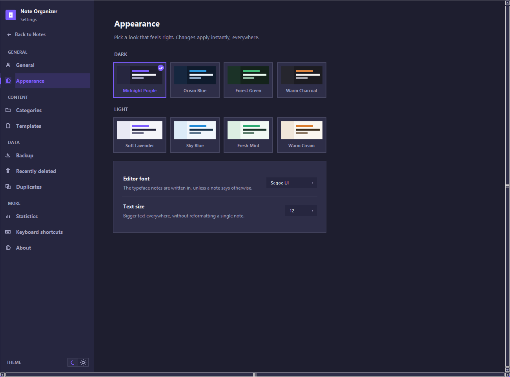

# Note Organizer

An offline notes app for Windows 11: rich text, tables, checklists, notes that
repeat, and a calendar that shows them. Python and Tkinter, with one
dependency (Pillow, for images).


[](https://github.com/AlexandraMoldovan95/noteOrganizer/actions/workflows/tests.yml)

**Try it without installing:** a [web demo](https://note-organizer-8f7772.netlify.app/demo/)
re-creates the app in the browser, in HTML and JavaScript, not the app itself.
**Written by Alexandra herself:** [In my words](docs/IN_MY_WORDS.md), and
[Bug reports](docs/BUG_REPORTS.md), what her own manual testing found.

## In five minutes

- **The app:** the pictures on this page, then the first page of the
  [user guide](docs/USER_GUIDE.md).
- **How it was made:** [how Note Organizer is built with an AI agent](docs/AI_WORKFLOW.md)
  — who decides, and how the agent's work is checked.
- **What went wrong, and what changed:** the
  [five stories](docs/ISSUES_LOG.md#start-here-five-stories) the issues log starts with.
- **How it is tested:** [four cases from the manual test plan](docs/TEST_PLAN_EXCERPT.md),
  and [how we test, in one page](qa/README.md#how-we-test-in-one-page).

## What it is

A notes app that keeps everything on your own computer: no account, no
cloud, no network calls — it opens a page in your browser only when you
ask. For people who want their notes, lists and dates in one place
they control.

- Notes with bold, italic, colours, sizes and lists; tables you edit in
  place; checklists; spelling checked with Windows' own dictionaries, and
  left alone in a language your computer has none for.
- Notes that repeat — daily, weekly, monthly, yearly — and a calendar that
  shows them, with any one day editable on its own, or moved to another date.
- Search, sort, group by category, or arrange the list by hand.
- A Trash to restore from (Settings → Recently deleted), and backups that
  move your notebook to another computer. A share code copies a note as
  text into another copy of the app.
- Eight themes, light and dark, and text that stays sharp on a screen
  Windows enlarges; keyboard shortcuts for the common actions, and a note
  list you can walk with the arrow keys.

| | | |
|---|---|---|
|  |  |  |

Every picture is a capture of the app itself, and its icon is drawn from
code ([where they come from](docs/screenshots/README.md)).

## Design choices

- **A delete you can undo is quiet; one you cannot is dark red.** Moving a
  note to the Trash wears red words on a quiet button; deleting a note from
  the Trash for good, or removing an attachment, is a dark red button. Each
  asks first, and on a question about something you cannot take back, Enter
  and Escape both give the safe answer
  ([questions](docs/USER_GUIDE.md#getting-started)).
- **Readable in every theme, measured.** Every coloured word, and every
  word on a button, meets WCAG AA in all eight themes, and CI fails on a
  pair that does not. The accent's fill is a design choice, not a measured
  pair: on the light green and cream themes it is under 3:1 against the
  sidebar ([contrast, measured](docs/ARCHITECTURE.md#contrast-measured)).
- **Meaning carried by shape as well as colour.** Save is the one filled
  button in the editor's row of actions, the open tab stands taller, the
  current find match is boxed —
  checked against colour-blindness simulations, and kept as a test case for
  a real colour-blind reader
  ([what a simulation is, and is not](docs/AI_WORKFLOW.md#ai-reviewers-and-simulations-what-they-are-and-are-not)).
- **Nothing you type is lost to a wrong field.** A date that cannot be
  read, an import that overlaps what you have, a note left half-written
  when you switch away: the app keeps what you wrote and asks, rather than
  guessing.

## Running it

Python 3.13, the version the tests run on:

```
pip install -r requirements.txt
py note_organizer.py
```

The notes stay beside the script when it runs from source (or in the
folder a `notebook_location.txt` beside it names, one path on a line), and
in a `Note Organizer` folder of their own in your profile, beside
Documents, when it runs as the packaged `.exe`
([building it](docs/RELEASE_WINDOWS.md)). On Linux, install Tk first
(`python3-tk`). The first start opens on a welcome note that shows each
part of the app.

## How it was built

Alexandra Moldovan built Note Organizer with Claude Code, Anthropic's AI
coding agent. She decided what the app should do and how it should behave,
chose between the options the agent put forward, went through the
[test cases](qa/NoteOrganizer_TestPlan.xlsx) by hand on the packaged app,
and approved every push and every merge; the final audit reaches `main` as
one pull request per app. The latest weeks of the history are that audit,
before the Microsoft Store: rounds of reviewers that read the app, its
documents and its test plan against the code, each finding fixed and its
fix read again ([the audit's record](docs/audit/README.md)). The agent wrote most of the code and the
documentation, working under the rules in
[CLAUDE.md](CLAUDE.md); what she turned down is kept with its reasons
([not planned](docs/ROADMAP.md#explicitly-not-planned-right-now)). Commits
the agent made carry a `Co-Authored-By` line naming the model
([counted](docs/AI_WORKFLOW.md#models)). How the work
is divided and checked: [built with an AI agent](docs/AI_WORKFLOW.md). The
few words the history uses in a sense of its own (a wave, a round, the
walk) are [the house words](CLAUDE.md#house-words).

> Everyone takes notes, whatever they do. I spent years in support — three
> of them at HP, documenting processes for teams who had to follow them —
> and I saw how much time is lost when notes are short or scattered. I
> wanted a simple, dependable place for them, that works offline and keeps
> your data on your computer. — Alexandra, [in my words](docs/IN_MY_WORDS.md)

## How it is tested

Every pull request that changes more than the documentation runs the whole
suite on Windows and on Linux. Most of it
drives the real app — clicking, typing, closing it and opening it again —
and checks what a person would notice: a note that must survive a restart,
a share code or a backup; formatting and tables that must come back exactly;
a question that must not lose what was typed. A fix lands with a check that
fails when the fix is taken away. To prove the checks catch what they
guard, a tool breaks the app on purpose, one small change at a time, and a
check must fail on each ([the last full run](docs/AI_WORKFLOW.md#how-the-agents-work-is-checked)).
The suite ran 91% of the app's lines on Windows ([measured](qa/README.md)), and CI holds
a floor of 80% on Linux; a line run is not a line checked, which is what
the breaking on purpose is for
([how we test, in one page](qa/README.md#how-we-test-in-one-page)).

## Speed

With 1,000 notes the app starts in about two seconds and saves a note in
about 12 ms; with 5,000, about two seconds and 42 ms. The release before
the note list was redrawn took 8 seconds to start and 10 to save at 1,000
([measured](docs/ARCHITECTURE.md#measured-at-1000-and-5000-notes)).

## Documentation

The [five-minute path](#in-five-minutes) is above. The rest is reference,
for when you need it:

- **Using it:** the [user guide](docs/USER_GUIDE.md) — every part of the app —
  and the [privacy policy](docs/PRIVACY.md).
- **How the code works:** [architecture](docs/ARCHITECTURE.md) — how it is
  organised, and why — and the [code tour](docs/CODE_TOUR.md), a walk
  through the files.
- **How it was made:** [in my words](docs/IN_MY_WORDS.md),
  [built with an AI agent](docs/AI_WORKFLOW.md), the
  [final audit's prompts](docs/audit/README.md), the
  [issues log](docs/ISSUES_LOG.md), the [changelog](CHANGELOG.md) and the
  [roadmap](docs/ROADMAP.md), with the decisions it records.
- **How it is tested:** the [test map](qa/README.md), the
  [test plan excerpt](docs/TEST_PLAN_EXCERPT.md) and the
  [bugs found by hand](docs/BUG_REPORTS.md).
- **The website and web demo:** [`site/`](site/README.md) — the page that
  presents the app, a demo to try it in a browser, and how both are built
  and published.
- **Releasing:** the [git workflow](docs/GIT_WORKFLOW.md), the release
  guides for [Windows](docs/RELEASE_WINDOWS.md) and
  [Android](docs/RELEASE_ANDROID.md), and the
  [Microsoft Store listing](docs/STORE_LISTING.md); the
  [archive](docs/archive/) holds two finished registers.

Until 1.0.0 the version counts what has shipped: the middle number is every
feature added so far, the last every fix
([the rule](docs/ROADMAP.md#versioning)).

## Known limitations

- The entry file is still large: it is the window's shared surface, split
  as far as measurement supports
  ([why](docs/ARCHITECTURE.md#case-study-deciding-the-split-with-a-call-graph)).
- Built for Windows 11, version 24H2 or later: the oldest Windows it was
  proved on, so the Store offers it nowhere older
  ([why](docs/RELEASE_WINDOWS.md#which-windows)). It runs on Linux too —
  the tests do — but its fonts and window behaviour are tuned for Windows.
- One computer at a time: notes move between computers by backup or share
  code, not by sync.
- Sharp at one screen scale: the main screen's. On a second screen at
  another scale, Windows resizes the app, a little soft there
  ([why](docs/ARCHITECTURE.md#sharp-on-a-scaled-screen-every-size-is-given-at-100)).
- Not for screen readers: Tk 8.6 draws its controls itself and describes
  almost none of them to Windows' accessibility interface, so a screen
  reader cannot read most of the window. What it does have: keyboard
  shortcuts for the common actions, a note list walked with the arrow
  keys, and words measured readable in every theme.

## License

[MIT](LICENSE) © 2026 Alexandra Moldovan
