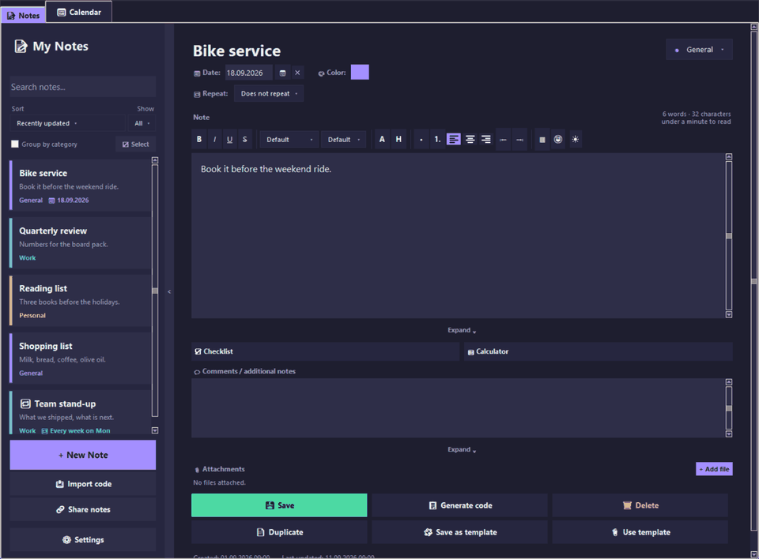
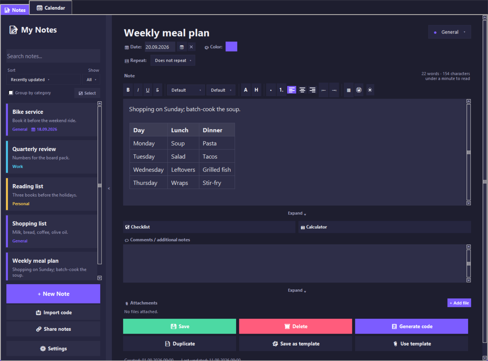
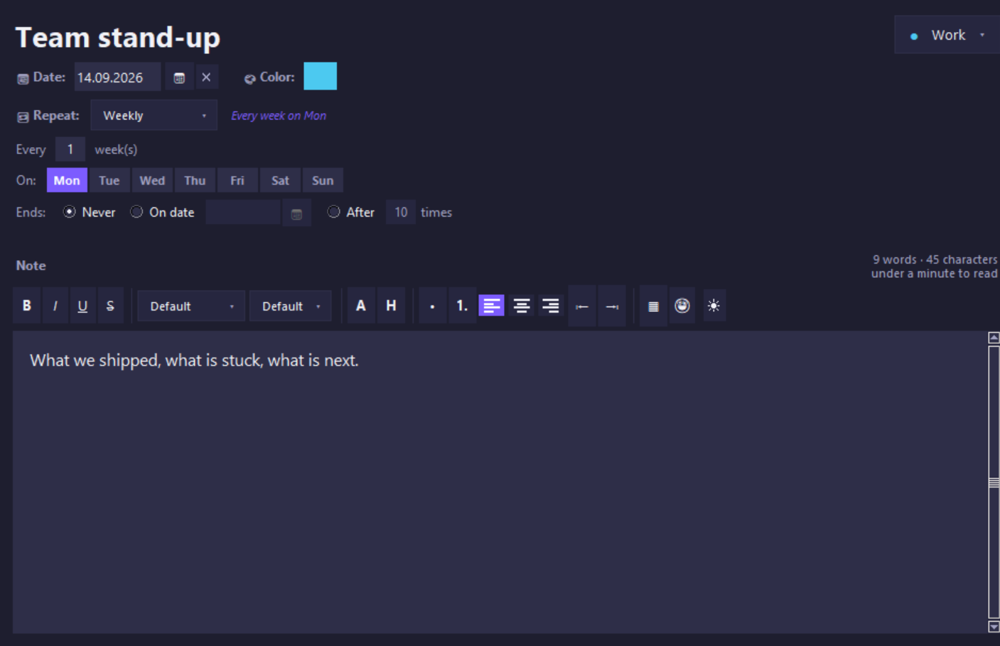
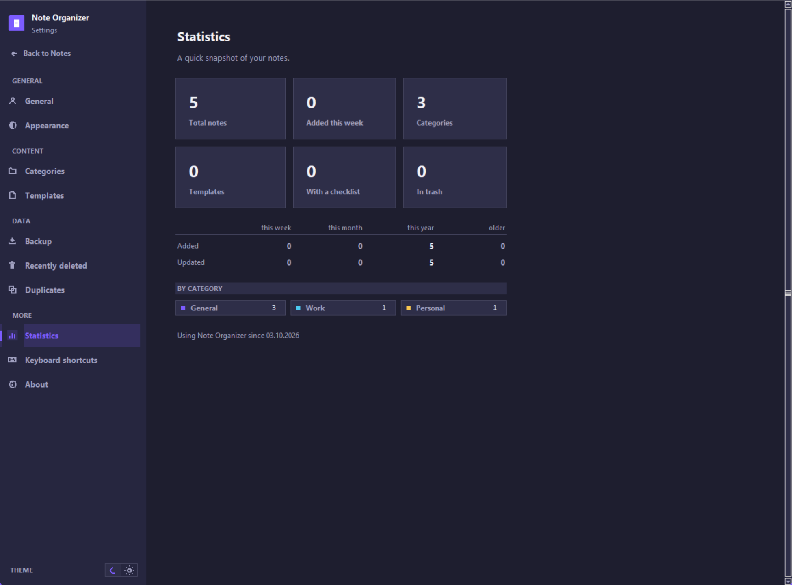

# Note Organizer

An offline notes app for Windows: rich text, tables, checklists, notes that
repeat, and a calendar that shows them. Python and Tkinter, with one
dependency (Pillow, for images).



[](https://github.com/AlexandraMoldovan95/noteOrganizer/actions/workflows/tests.yml)

## What it is

A notes app that keeps everything on your own computer: no account, no
cloud, no network calls. For people who want their notes, lists and dates
in one place they control.

- Notes with bold, italic, colours, headings and lists; tables you edit in
  place; checklists.
- Notes that repeat — daily, weekly, monthly, yearly — and a calendar that
  shows them, with any one day editable on its own.
- Search, sort, group by category, or arrange the list by hand.
- A Trash to restore from (Settings → Recently deleted), and backups that
  move your notebook to another computer. A share code copies a note as
  text into another copy of the app.
- Eight themes, light and dark; keyboard shortcuts for the common actions,
  and a note list you can walk with the arrow keys.

| | | |
|---|---|---|
|  |  |  |

Every picture is a capture of the app itself, and its icon is drawn from
code ([where they come from](docs/screenshots/README.md)).

## Running it

Python 3.13, the version the tests run on:

```
pip install -r requirements.txt
py note_organizer.py
```

The notes stay beside the script when it runs from source, and in
`%APPDATA%\NoteOrganizer` when it runs as the packaged `.exe`
([building it](docs/RELEASE_WINDOWS.md)). On Linux, install Tk first
(`python3-tk`).

## How it was built

Alexandra Moldovan built Note Organizer with Claude Code, Anthropic's AI
coding agent. She decided what the app should do and how it should behave,
chose between the options the agent put forward, tested the builds by hand
and approved every change before it was merged. The agent wrote most of
the code and the documentation, working under the rules in
[CLAUDE.md](CLAUDE.md). Commits it made carry a `Co-Authored-By` line;
the first ones, from before that convention, do not.

## How it is tested

Every pull request runs the whole suite on Windows and on Linux. Most of it
drives the real app — clicking, typing, closing it and opening it again —
and checks what a person would notice: a note that must survive a restart,
a share code or a backup; formatting and tables that must come back exactly;
a question that must not lose what was typed. A fix lands with a check that
fails when the fix is taken away, and the mutation runner keeps proving it.
The suite executes 89% of the app's code
([how we test, in one page](qa/README.md#how-we-test-in-one-page)).

## Speed

With 1,000 notes the app starts in about two seconds and saves a note in
about 12 ms; with 5,000, about two seconds and 42 ms. The release before
the note list was redrawn took 8 seconds to start and 10 to save at 1,000
([measured](docs/ARCHITECTURE.md#measured-at-1000-and-5000-notes)).

## Documentation

Start with these three:

- [User guide](docs/USER_GUIDE.md) — every part of the app, how to use it.
- [Issues log](docs/ISSUES_LOG.md) — what went wrong, why, and what changed
  because of it.
- [Architecture](docs/ARCHITECTURE.md) — how the code is organised, and why.

And when you need them: the [code tour](docs/CODE_TOUR.md), the
[changelog](CHANGELOG.md), the [roadmap](docs/ROADMAP.md), the
[test map](qa/README.md), the [git workflow](docs/GIT_WORKFLOW.md), the
release guides for [Windows](docs/RELEASE_WINDOWS.md) and
[Android](docs/RELEASE_ANDROID.md), and the [archive](docs/archive/) of
two finished registers.

Until 1.0.0 the version counts what has shipped: the middle number is every
feature added so far, the last every fix
([the rule](docs/ROADMAP.md#versioning)).

## Known limitations

- The entry file is still large: it is the window's shared surface, split
  as far as measurement supports
  ([why](docs/ARCHITECTURE.md#case-study-deciding-the-split-with-a-call-graph)).
- Some accent-coloured text and buttons are below WCAG AA contrast; every
  pair is measured, and the fix is a design choice still to be made
  ([the table](docs/ARCHITECTURE.md#contrast-measured)).
- Built for Windows. It runs on Linux too — the tests do — but its fonts
  and window behaviour are tuned for Windows.
- One computer at a time: notes move between computers by backup or share
  code, not by sync.

## License

[MIT](LICENSE) © 2026 Alexandra Moldovan
