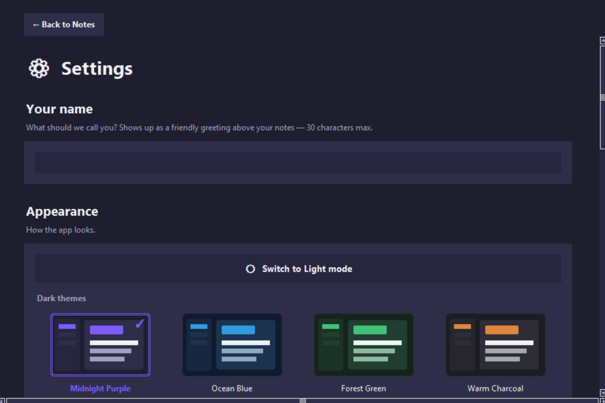
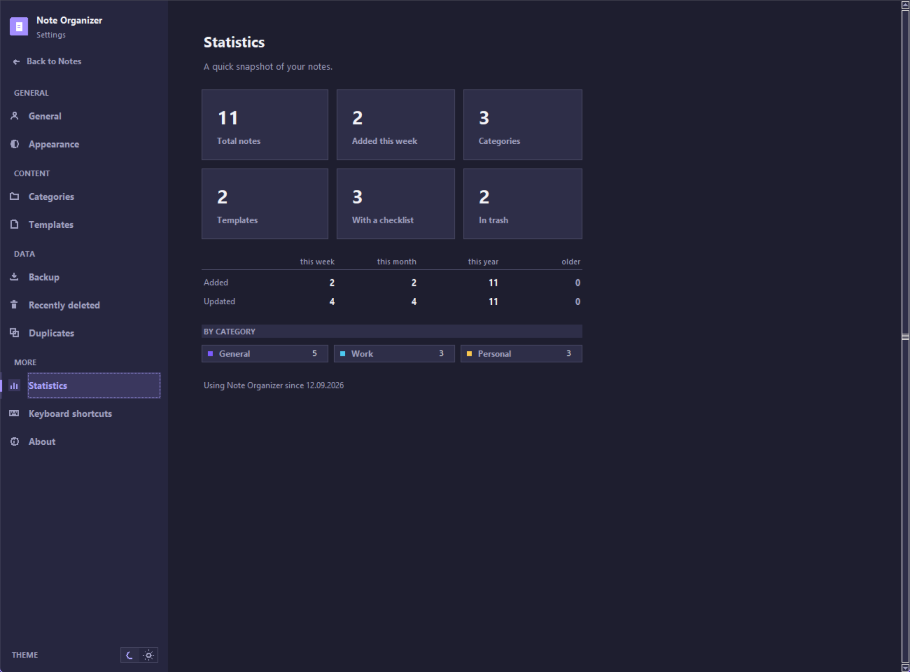

# In my words

*Alexandra Moldovan, who builds Note Organizer. Most of this project's documentation is written by
the AI agent I build it with. This page is mine.*

## Contents

- [Why a notes app](#why-a-notes-app)
- [What I brought from support](#what-i-brought-from-support)
- [How I work with the agent](#how-i-work-with-the-agent)
- [The rules I set](#the-rules-i-set)
- [Decisions I made](#decisions-i-made)
- [How I test](#how-i-test)
- [The app on Android](#the-app-on-android)
- [What I learned](#what-i-learned)
- [What I would do differently](#what-i-would-do-differently)
- [What comes next](#what-comes-next)

## Why a notes app

Everyone takes notes - students, office workers, doctors, lawyers. Reading and writing are among
the first things we learn at school, and we keep using them to learn for the rest of our lives.
We write things down so we don't forget them, so we can study, or so we can pass an idea on. I
wanted to make a simple app that does that well, for anyone.

I started it in July, around the time I began a course in AI-assisted programming, as a project
of my own: a way to put what I was learning into practice. The course taught Python, so the app
is in Python. Its history on GitHub starts in August, when I put it under version control.

It works offline on purpose. When I started, I was still finding my feet with AI, and I didn't
want to pay for API keys whose usage I couldn't control, or that others could take advantage of. I
had also noticed how carefully companies guard their data, so it isn't exposed. An app that never
sends anything anywhere suits both.

## What I brought from support

Before this I worked in support for several years: customer support for games at Teleperformance,
on an EA project, and at Playtika, and three years in technical support at HP. I also did a
little crowdtesting on uTest.

At HP I was in first-line support, between the business and the development teams. We received
problems from the business, checked them, triaged them, and sent each one to the development team
that owned the tool. Part of the job was documenting the processes we followed, in OneNote, and
they had to be written so that someone else could follow them: there were many tools and many
teams, and everyone needed to know their part.

I saw how much time is lost when notes are short, when the real explanation is buried in years-old
email threads attached to a page, or when the person who wrote a process has moved to another role
or left. I spent a lot of time tracking people down to ask what a note meant. That is where my
habit comes from of writing things down completely and clearly, so that I can do my work well and
the people around me don't have to search for answers. It is also why the documentation of this
project matters so much to me.

I am a serious, organised person. I like to work on something until every detail is right, and I
can't leave a thing broken or half-done - it stays on my mind until I fix it.

## How I work with the agent

There are two of us working on the app, the agent and me, and alongside us, single-use AI agents
that each play a role for a while: they analyse the app, try to break it, review it from different
points of view, and the agent repairs what they find.

1. **We plan together.** We write our ideas in the roadmap. I bring mine and I encourage the agent
   to bring its own, then we agree on a plan.
2. **We build in parts.** One feature or a few small ones at a time, never several big changes at
   once. Doing too much at once is how things break, and then the bugs have to be found again
   through audits and test cases, which is more work for both of us. Being proactive pays off - I learned that at HP.
3. **The agent writes the code**, guided by my prompts, by audits, and by those review agents.
4. **I run the app and test it**, and say what still needs adjusting.
5. **The agent writes the pull request and, when there is a bug, the issue.** I read the texts,
   open them on GitHub, watch the CI checks, and merge when everything is green. We always work on
   branches, never on `main`, so the main code - and the app - stays safe.

We set up CI to make the work easier: one more safety net, one more filter the code goes through,
which also finds bugs that can slip past the editor. How much we cover in a day depends on how many
bugs we find and how much needs adjusting.

And because I try to think ahead, I agreed with the agent that every change goes through the list
of features it touches, to prevent bugs before they happen - and that when a bug does happen,
fixing it is not enough: we find its root cause, so the same conditions can't produce another one.

## The rules I set

Most of the rules in [CLAUDE.md](../CLAUDE.md) I thought of as I ran into things.

I started with safety: making sure I stay in control of what the agent does, so that what we
deliver is good. I wanted it to analyse and come up with ideas, but also to know when to stop,
instead of working more than needed or without a purpose. I worked in a balanced way to make a
balanced product.

As the app grew, I added more rules: to be organised; to work with review agents, imagining people
who examine the app and try to break it while it repairs it, so the app is solid from every side;
and to work in a loop until something is done properly. I made sure it knows who it works with and
what my background is, so it adapts to how I work. It always asks before pushing anything to
GitHub, so I can test the app first. And from the beginning I made sure I could learn from what
it does, to communicate with it better and to keep the experience myself.

The rule I care about most came from a check that failed now and then. The agent ran it again, it
passed, and that was meant to settle it. I told it that isn't a fix. We always look for the root
of a problem and fix it there, not on the spot, case by case. Patching each case only grows the
work for no reason; fixing the cause stops the same problem from coming back, so we can move on to
other tasks and cover more of the app. Working in a loop with review agents serves the same idea:
they check for every kind of problem that can appear, and we keep going until all of them, or
nearly all, are solved.

After going through all this, I'm sure the next app I make will be even more organised than this
one.

## Decisions I made

These are a few of my decisions, picked as examples - not the only ones. I made the rest the same
way: the agent puts forward options, and I choose what the app does and how it behaves.

- **No language selector.** This is the first app I've built end to end this way. A language
  selector would have been hard to build, and I don't have the people to check six or seven
  languages for correct writing. I didn't want to risk badly written translations in the app.
- **Templates don't go through the Trash.** We were close to finishing, and I didn't want to risk
  breaking the app or adding bugs for a feature that would have meant a lot of extra work. There is
  a safety net: deleting a template shows a clear warning that it is gone for good. A template is
  also easy to write again, and you can keep copies. I weighed the need against the work it would
  take and decided it wasn't worth it; if it had been truly important, I would have made the time.
  It would also have filled the app with code for no good reason and cost it its simplicity: in
  the Trash, templates would have mixed with notes, the Trash would have needed a new design, and
  the app might not even have told a template from an ordinary note reliably.
- **The checklist's arrows sit beside the checkboxes.** Priorities change, so a to-do list needs
  to be reordered. At first the ▲ ▼ arrows were beside each item's bin. I moved them next to the
  checkboxes, because a slip of the mouse could delete an item instead of moving it.
- **Settings was redesigned.** After a rework, Settings had the section names on one side and their
  buttons in the middle of the page, and I was zig-zagging with my eyes to take it all in. The
  sections weren't grouped either, so the page didn't feel clean or easy to use. I described to
  the agent how it should look, made a separate mock-up in HTML of what it could be, and then we
  built it into the app. Today I wouldn't change anything: for an app this simple, it has every
  setting a user needs.

| Settings before the redesign (20 August) | Settings now |
|---|---|
|  |  |

*Both pictures are of the app itself. The first is the code of 20 August, run again on a made-up
notebook.*

The first two, and the other ideas we decided against, are listed in the roadmap, under
[Explicitly not planned](ROADMAP.md#explicitly-not-planned-right-now).

## How I test

I go through the whole interface: I imagine scenarios, the buttons a user would press and the
combinations worth trying, and I test them. I test on a dark and a light theme side by side as
much as I can, to see how each feature feels on both. When something doesn't look right, or
doesn't feel right from a human point of view, I ask the agent to look into it and we adjust it
together. While it works I often add small tasks or things to check, so the feature comes out
complete.

At the beginning, before our work was this organised, I found more bugs by hand than the automated
checks did. Now, whenever I find one, we add a check that would catch it, and mutants to prove the
check really works. I still find some by hand, fewer than before, and sometimes the automated
checks missed them and had to be reworked. So manual testing can never leave the picture. Even
when no technical bug is left, there are visual ones, and things no script can judge: whether a
feature feels right to a person. A test can pass and still not meet what the user expects. And as
one of the principles of testing says, finding no more bugs doesn't mean there are none - maybe I
just haven't imagined the scenario that finds them yet.

**Two bugs I found.** I was testing the Share panel, selecting several notes to make one share
code, and the notes wouldn't select. I switched to a light theme and there was no problem. On the
dark themes the tick simply didn't show - the notes were selected, but nothing on screen said so.
I reported it in detail, so the agent would know exactly where to look. Another time I noticed
that every theme change showed a "Note updated" message, although no note had changed. Small bugs
like these - a message with no reason, a flicker that took long sessions to get rid of, a cursor
that stayed in a search box after I clicked elsewhere - can be found all along the way. Explained
well and in detail, they can all be solved; and if not, we adapt and change things until they
work.

**The first one, from the screen to the code.** I was following the test cases in the Excel file,
testing each one on a light and a dark theme in turn, as I usually do. On the dark themes the
ticks didn't appear, and at first I thought ticking didn't work at all - that is how I reported
it. Then I ran the same tests on a light theme, and there the ticks appeared as they should. So I
changed my report: on the dark themes the ticks are there, they just can't be seen. I had two
ideas about the cause, a function that didn't work or a colour problem, and the light theme
settled it: it was the colour. The cause in the code was simple: the tick was drawn in the same
colour as its box, so it was invisible. I try to be this specific in every report, so the
developer can isolate the problem and fix exactly that.

After the fix comes retesting and regression testing. I checked every place in the app where a
box can be ticked - Group by category, Settings → Duplicates, Recently deleted, Select mode in
the note list, the Share panel - then did a short smoke test: buttons, tabs, exporting notes
through the Share panel. I always test on a dark and a light theme, usually on one colour each,
sometimes on the blue, green or brown ones too. What it taught me: colours and functions can
overlap until something becomes invisible, so we always have to make sure they fit together.

Some of the bugs my manual testing found are in [Bug reports](BUG_REPORTS.md), as examples, three
of them written out in a standard bug-report format; all the others are recorded in the test plan.

**What surprised me most** was how long and careful testing can be. But that is how I learned to
describe a problem clearly enough for a developer to know what to look at and fix. A small feature
everyone knows can be hard to explain if you don't have the words for it. It was a challenge, and
I'm glad I went through it. It also made me decide to take the ISTQB Foundation certification,
which I'm preparing for.

## The app on Android

The phone app is not very different from the desktop one: I wanted it to mirror every feature
of the desktop as closely as possible. The big difference was how everything had to be laid
out. A phone's screen is not a desktop's, and there is no mouse or keyboard, only a finger, taps
and the phone's own keyboard, so with the agent's help we rethought the design to make it
simpler and easy to use.

I built it because I use Android and can test on it, and because I have always wanted to
publish a project of my own that anyone can use. I didn't consider iOS: I have no way to test on
those devices, and rather than guess and get it wrong, I made a conscious and responsible
decision to work where I can test.

Three of the phone's design decisions:

- **The checklist, the comments and the calculator are added from the ⋮ menu at the top
  right.** We built the options; each user takes what a note needs. If a note doesn't need a
  checklist, there is no reason to show one in it and weigh the page down.
- **The table is as adjustable as I could make it.** There is no mouse on a phone, so its cells
  are written in place, its rows can be dragged taller or shorter, and its columns made wider or
  narrower, to fit whatever the user needs it for.
- **One Light | Dark switch in Settings → Appearance.** I kept it as simple as possible, so the
  user is free to choose any theme in light or in dark mode.

It is a simple app, so I wanted its features to be as easy to use as possible. The bugs I found
on my own phone, one written out in full, are in [Bug reports](BUG_REPORTS.md#on-the-phone).

## What I learned

Software can be hard and painstaking: you have to think in detail about what comes next, so you
don't break what works. Testing has to be renewed all the time, with features tested and retested
to make sure everything works as it should. And working with AI connects all of it: you have to
speak clearly, in detail and logically, to build something from start to finish without getting
lost.

Three moments taught me the most:

- **Keep the notes apart from the code.** Early on, tests run from the wrong folder deleted my real
  notes, and only the backup the app makes for itself brought them back. Since then my notes live
  in a folder of their own, never where the code is written and tested.
- **Test as the user, not only against my own definition of done.** I hadn't noticed that the text
  was blurred on a screen enlarged to 150% until I saw a before-and-after picture, because I keep
  the app on a monitor. I have to put myself in the users' place and imagine what would work for
  them, because they are the ones who will use it.
- **Edge cases can cause the biggest problems without anyone noticing.** Pasting a text of more
  than 50,000 words froze the app. That is why I keep asking the agent to make the app run well on
  the weakest and the strongest PCs it can run on, to avoid crashes, slow loading, flicker and
  other problems.

**From the final audit.** I learned how organised I have to keep my work to be able to check it
again at the end. The audit took a long time to carry out and to finish, because many things
had not been set up well from the start. What surprised me was how many small things the agents
caught in their checks: bugs that my own testing of the app had not found. Expecting that we
would keep running into them, I wanted the audit as thorough as it could be, in a loop, checking
and re-checking the whole test plan, the code, the app's logic, its security and robustness, and
that it works as expected, as an ordinary offline notes app should.

**When to stop.** As the principles of testing say, testing can show that defects are present
but cannot show that there are none, and exhaustive testing is impossible. No app can be tested
and confirmed free of bugs; there will always be defects, smaller or larger. So we prioritised
what mattered most for the app to be good to use, and whenever it is needed, we test again and
fix what we find. I set the rule of two clean rounds in a row so that the most important things
pass the filter of testing clean, and left the small ones to be fixed at the end, so the app
could be finished and published. Testing and retesting without end could break it for no
reason, or turn into rituals that never end.

**Working with the agent.** I thought I could work with the agent in broad strokes, but testing
showed me that requests have to be as specific as possible for the communication to work - and
so do test cases: if they are not written clearly and to the point, a problem cannot be fixed
precisely. Two moments showed me why the checking has to be mine:

- On 15 November the rounds were reading the test plan in samples, and the agent proposed
  stopping there; I asked for the whole plan to be read again, case by case. It showed us how much was still left to fix in the code and the app.
  Had we not gone through all of it, we would not have found the remaining defects before
  publishing.
- The phone's test plan had not been walked correctly by the agents: cases had been marked Pass
  from runs that covered only part of them. I realised it through the checks and re-checks, set
  them back to Not Tested, and then tested them as they should be.

## What I would do differently

I would make a more detailed work plan at the start, get to know the AI before giving it work - so it knows who it is working with - and set clearer working rules from the beginning.

More concretely:

- I would write the documentation for readers outside the project, and file bugs in a standard
  report format, from the start, so the history of the issues would be cleaner.
- I would use audit rules and loops of review agents sooner and more often. They would have been
  at hand much earlier if I had known how to use them.
- Had I tested gradually instead of letting the test cases pile up, I wouldn't have spent so long
  checking them all at once. But I chose to run them near the end, when the app was almost
  finished and every case could be covered. Otherwise I would have run the same cases many times
  over, as regression testing after every change to the code. So I'm half at peace with that
  choice.
- I might have built the app in HTML from the start instead of Python, to make it more modern and
  nicer to look at. Python was still a good way to learn.
- If I started again, I would pass my ideas and features through many more filters before
  building them, so each one could be added properly everywhere it belongs.

Now I know how to organise my work better, and what approach to take for the next apps I build.

## What comes next

It is hard to judge my own app objectively. What bothers me is that it is still a first version,
when other apps are so far ahead. I plan to keep improving it as I gain experience; I don't intend
to leave it. There are always details to consider - some I can't see yet, but I'm sure I will.
The Android app now follows the desktop, so your notes can come with you. When the apps launch,
I will ask for feedback - from colour-blind readers too - and improve them from there.

I left for after the launch what changes much of what a user sees, or touches the code in many
files: one set of icons, a screen that says clearly when no note is open, splitting the largest
files, and automated tests on the phone's screens. All of them are useful, but each could have
broken something that works now, and would have called for the whole audit again. I preferred
to publish an app that has been checked, and to do them one at a time after the launch, guided
also by what the people who use it tell me.

One person has tried the app so far, mostly out of curiosity. They noticed how simple it is, how
easy to use, and how handy it can be for anyone. On the minus side, it still had small bugs at
the time, since it was not yet fully checked; they did not look at it in depth, and found
nothing serious to correct.

---

*Everything here comes from me: what I lived, what I decided and why. The agent helped me put it
into a page, and I checked every sentence. - Alexandra Moldovan, October and November 2026*
