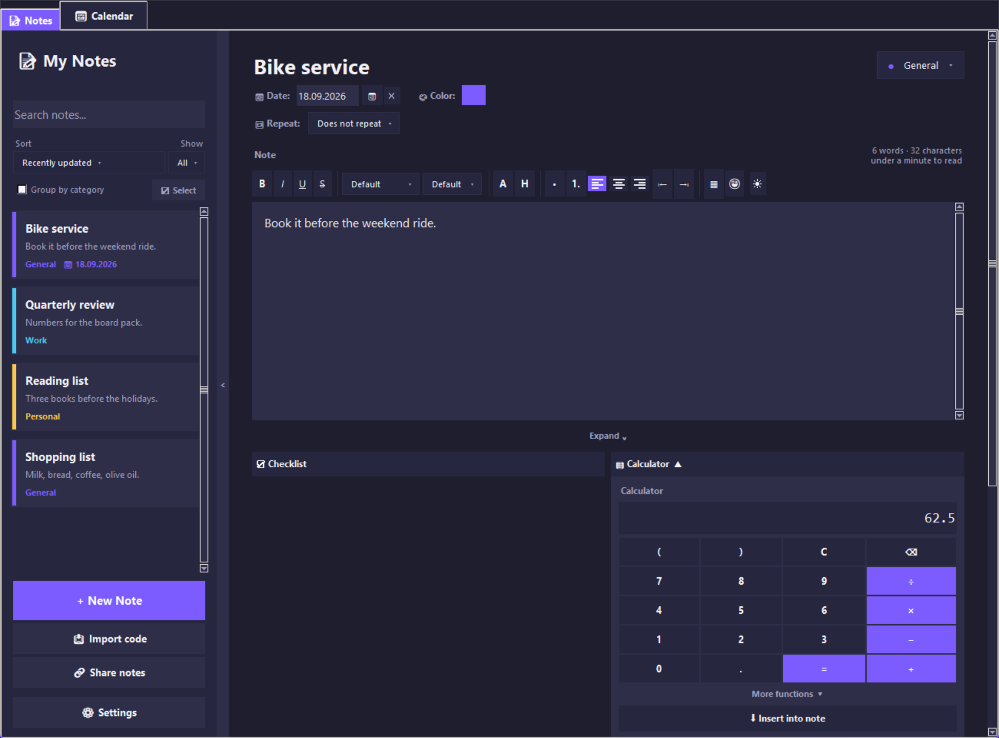
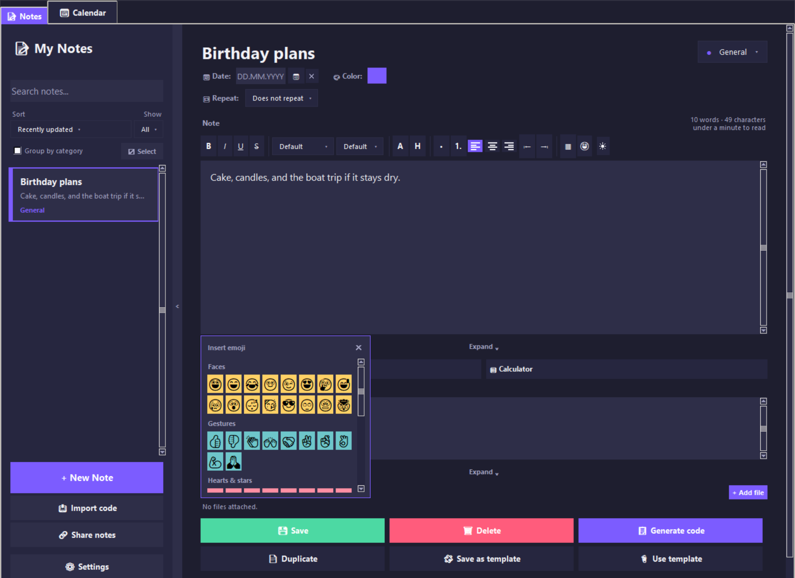
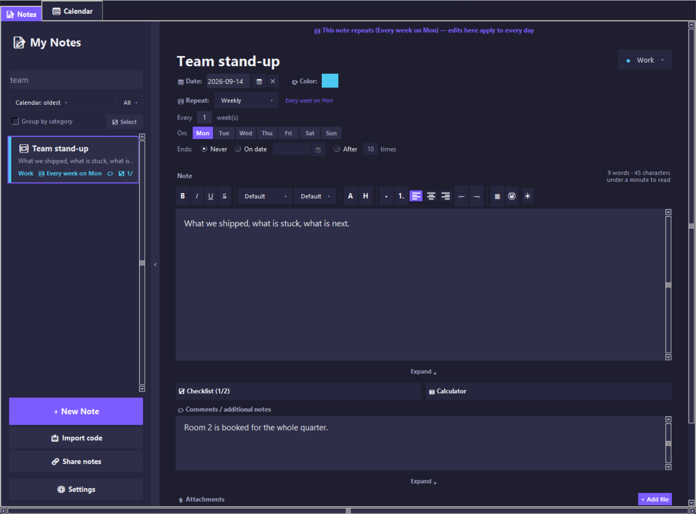
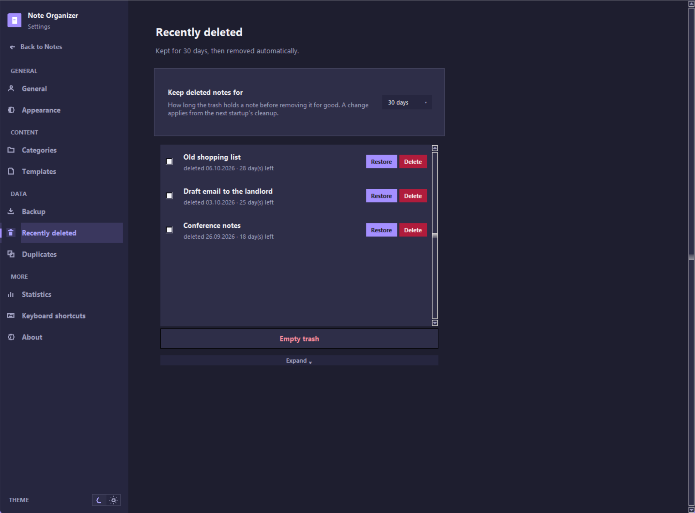

# User Guide

A full walkthrough of Note Organizer — what it does, and how to use it, with a screenshot for every major feature.

---

## Getting started

Note Organizer runs as a single window with two tabs, **Notes** and **Calendar**, plus a **Settings** page reached via its own button at the bottom of the sidebar. Everything is stored locally, next to the app — there's no account to create and no internet connection required.

---

## Notes

### Creating and editing

Click **+ New Note** in the sidebar to open a blank editor. A note has a title, a body, optional comments, a category, an optional date, an optional color, and an optional checklist. There's only ever one editor open at a time — clicking a different note in the list automatically saves whatever you were working on first, so there's no tab-juggling and no risk of losing an edit.

Notes save automatically a moment after you stop typing (look for the "Auto-saved" status), and always save immediately when you switch to a different note.

### Formatting

A small toolbar above the note body is split into four groups, separated by thin dividers. The first three — the style toggles, the font dropdowns, and the two colour buttons — change the characters you select. The last changes whole lines. Hover any button and it tells you what it does. **Style**: **Bold**, *Italic*, <u>Underline</u>, and ~~Strikethrough~~ — also on the right-click menu, and available as keyboard shortcuts (**Ctrl+B**, **Ctrl+I**, **Ctrl+U**, **Ctrl+D**). **Colors**: text color and highlight, each opening a small swatch picker (no hex codes to type — just pick a color) with a Clear option to remove it again. All six work the same way: select some text and click (or press) one to apply it there, or click one with nothing selected — it "sticks" for whatever you type next, until you click it again to turn it off. Text color and highlight can be combined with each other and with any of the four styles.

**Paragraph** applies to whole lines — whichever lines your cursor or selection touches, so you don't need to select a line exactly.

- **Lists.** The **•** and **1.** buttons turn those lines into a bullet or numbered list. Click the same button again to turn the list off. Press **Enter** to start the next item; press it on an item you haven't typed anything into and the list ends there. **Backspace** with the cursor just after a marker removes the marker rather than deleting it one character at a time.
- **Nesting.** **Tab** pushes a list item one level in, **Shift+Tab** pulls it back out — or use the **⇤** and **⇥** buttons. A numbered sub-list counts from 1 again under each parent, and picks the outer numbering back up when it ends. Bullets change shape as they go deeper (•, ◦, ▪). Outside a list, Tab still types a tab; the two indent buttons work on any paragraph, list or not, up to eight levels.
- **Alignment.** The three bar icons set a line left, centred, or right. Clicking the alignment a line already has puts it back to left.

These combine: a bullet can be centred, an indented paragraph can be right-aligned, and any of it can carry bold or a text colour.

List markers are part of the note's own text — a bullet really is a "• " at the start of the line. That's deliberate: it means a list still looks like a list when you export the note, share it as a code, or paste it into an email. The indenting is drawn by the app on top of that.

**Font** sets the typeface and size. Pick from either dropdown to change the selected text, or pick with nothing selected and it applies to whatever you type next — the same way the Style buttons work.

- **Default** means "no setting of its own", so that text follows whatever the editor's default is. It is how you undo a size or a typeface, rather than setting it back by hand.
- If you select text that mixes two sizes, the dropdown shows **Default** rather than picking one of them — otherwise it would look like the whole selection was already that size.
- The eight typefaces are ones that come with Windows. That is deliberate: if a note used a font the person you send it to doesn't have, their computer would quietly swap in a different one and nothing would say so.

**To make everything bigger**, don't format each note — go to **Settings → Appearance** and set **Editor font** and **Text size**. That is the size notes start at; anything you set from the toolbar overrides it just for that text. This is the setting to reach for if the default is simply too small to read comfortably.

Still ahead: paste that keeps (or discards) formatting from wherever it was copied.

A title can be up to 200 characters. That is far more than a title needs, and it keeps the field quick to type in — a very long one makes the box itself sluggish. Pasting something longer shortens it to fit. Titles saved before this limit existed are left exactly as they are.

### How long a note takes to read

Under the word and character counts, each note shows roughly how long it takes to read — "under a minute to read" for a short one, "about 4 minutes to read" for a longer one.

It is worked out from the word count at 200 words a minute, which is the slow end of normal adult reading. That is on purpose: finishing sooner than promised costs you nothing, whereas being told a note is shorter than it really is does.

### Attachments

Attach one or more files to a note from the editor. Attached files show as a small list with their name and a way to remove them; click a file to open it. Removing an attachment deletes it from that note only — it doesn't touch anything else.

### Checklists

Any note can have a checklist. Click **☑ Checklist** in the editor to open it, add items, and check them off as you go — the note's card in the list shows progress at a glance (e.g. "☑ 2/5").

### Calculator

Click **🧮 Calculator** in the editor, next to Checklist, for a collapsible built-in calculator — standard arithmetic with real operator precedence, three interchangeable bracket styles, a square root, powers, and percent, either from the on-screen buttons or by typing/pasting an expression directly. Press **=** to see the result, then **Insert into note** to drop the whole formula (not just the answer) into the note body — repeated inserts stack cleanly below each other. A collapsible history keeps every calculation from the session, with a Clear button and click-to-insert on any past entry.

### Emoji

Any text field in a note (title, body, comments) can have an emoji inserted at the cursor via the right-click menu, without leaving the keyboard to hunt through the system emoji picker.

### Finding notes: search, sort, and grouping

Search the note list by keyword, and sort by recency, title, category, or date, from the controls above the list.

**Group by category** (checkbox above the note list) clusters the list under collapsible category headers instead of one flat list — click a group's header to collapse or expand it; the state is remembered.

### Organizing

- **Pin** a note (right-click → Pin) to keep it at the top of the list regardless of sort order.
- **Duplicate** a note to create an editable copy, titled "(copy)".
- **Categories** act as folders — create, rename, recolor, or delete them from Settings → Categories. Deleting a category with notes in it asks where to move them first; nothing is ever silently lost.

### Templates

Save any note as a reusable template (📋 **Save as template**), or build one from scratch in Settings → Templates. Starting a new note with **Use template** fills in the title, body, category, and checklist from the template — the template itself is never affected by what you do with the note afterward.

### Trash

Deleting a note moves it to **Recently deleted** (Settings), where it's recoverable for a configurable retention window before being purged automatically. Restore individual notes, delete them permanently one at a time, or empty the whole trash at once. With a lot of deleted notes, the list loads the most recent batch first, with a button to reveal more — so it stays quick to open no matter how much has accumulated there.

### Finding & cleaning up duplicates

Settings → **Duplicates** groups notes that match on title, body, comments, and category. Within a group, tick specific copies to remove (the rest are kept — nothing forces "keep exactly one"), or use **Clean up ALL groups** to apply "keep the first, remove the rest" across every group in one click.

---

## Recurring notes

Any note can repeat. Open the **Repeat** section in the editor and choose:

- **Daily**, with a custom interval (every N days)
- **Weekly**, on specific weekdays
- **Monthly**, on specific days of the month — with a choice of what happens in shorter months (e.g. a note set for "the 31st": either land on that month's *last* day, or be *skipped* entirely that month)
- **Yearly**, on a specific date

Set an end condition if the note shouldn't repeat forever: after a number of occurrences, or by a specific date.

Editing or deleting one specific occurrence (rather than the whole series) is always offered as a separate choice — your edit only applies where you meant it to.

---

## Calendar

The Calendar tab shows every note (including every occurrence of every recurring note) on the day it falls on. Navigate month-to-month, jump directly to a specific month/year, or return to today. Multiple notes on one day show up to two title previews plus a "+N more" indicator; hovering a day gives a quick summary.

You can also paint a specific calendar day a custom color (right-click it), independent of any note's own color — useful for marking something about the day itself, like a holiday or deadline.

---

## Sharing & backup

### Share a note as a code

Open a note → Generate code. This generates a compact block of text representing that note's content (not its attachments) — paste it to someone else, and they can import it with **Import code** in the sidebar. You can also select several notes at once and generate one code covering all of them.

### Import a code

Paste a code you received into **Import code** in the sidebar. If any of the notes it contains look identical to ones you already have, you'll be asked whether to skip the duplicates, import everyone anyway, or cancel — nothing is silently duplicated.

### Full backup: export

Settings → Export notes creates a single `.zip` containing every note, your settings, and every attachment — the one file you need to move everything to another device. With a lot of attachments this can take a moment; a progress bar stays visible at the bottom of the window the whole time, and the app remains fully usable while it works.

### Full backup: import

Settings → Import notes brings a previously exported `.zip` back in — notes, settings, and attachments together. Just like importing a code, you'll be asked about any notes that look identical to what you already have before anything is added.

---

## Settings

Categories, templates, trash, duplicate cleanup, appearance, your name, and usage statistics all live on one page, reached via the **⚙ Settings** button at the bottom of the sidebar. The page is split in two: a list of settings on the left, and whichever one you picked on the right. One section shows at a time, so you're only ever looking at the setting you came for. A **← Back to Notes** button at the top returns you to your notes.

### Your name

Settings → Your name sets the greeting shown above the note list ("Hi \<name\>,"). Leave it blank for no greeting.

### Statistics

A quick snapshot of your total note count and this week's activity, with a clickable chip per category — click one to jump straight to your notes filtered to that category.

---

## Appearance

Switch between Dark and Light mode, and pick from four variants of each, in Settings → Appearance. The choice is remembered the next time you open the app.

---

## Adding your own screenshots

Drop image files into `docs/screenshots/` using the exact filenames referenced above. Once a file exists at that path, it renders automatically wherever this guide references it — no other changes needed.

| Filename | What to capture |
|---|---|
| `main-window.png` | The main window, Notes tab, with a few notes in the list |
| `note-editor.png` | A note open in the editor, with some content filled in |
| `formatting-toolbar.png` | The formatting toolbar, with a mix of bold/italic/underlined/struck-through/colored/highlighted text visible in the body |
| `attachments.png` | The attachments section of a note with at least one file attached |
| `checklist.png` | The checklist section open, with a mix of checked and unchecked items |
| `calculator.png` | The calculator section open, with an expression entered and its result inserted into the note |
| `emoji-picker.png` | The emoji picker open over a text field |
| `search-and-sort.png` | The search box and sort dropdown, ideally mid-search |
| `grouped-notes.png` | The note list with "Group by category" on, showing at least two groups (one collapsed, one expanded, if possible) |
| `categories-panel.png` | Settings → Categories, with a few categories listed |
| `templates-panel.png` | Settings → Templates, with at least one template listed |
| `trash-panel.png` | Settings → Recently deleted, with a few entries |
| `duplicates-panel.png` | Settings → Duplicates, with at least one group showing |
| `recurrence-setup.png` | The Repeat section of the editor, mid-setup (e.g. Weekly with a couple of days picked) |
| `calendar-view.png` | The Calendar tab, a month with a few notes visible on different days |
| `calendar-day-color.png` | The right-click menu / result of painting a calendar day a custom color |
| `share-panel.png` | The Share notes panel with a couple of notes ticked |
| `import-code.png` | The Import code panel, ideally showing the duplicate-check prompt |
| `export-progress.png` | The export progress bar visible at the bottom of the window mid-export |
| `import-backup.png` | The Import notes file picker or its resulting confirmation |
| `settings-overview.png` | The Settings page, showing the section list on the left and a section open on the right |
| `theme-picker.png` | Settings → Appearance, with the theme variant cards visible |
