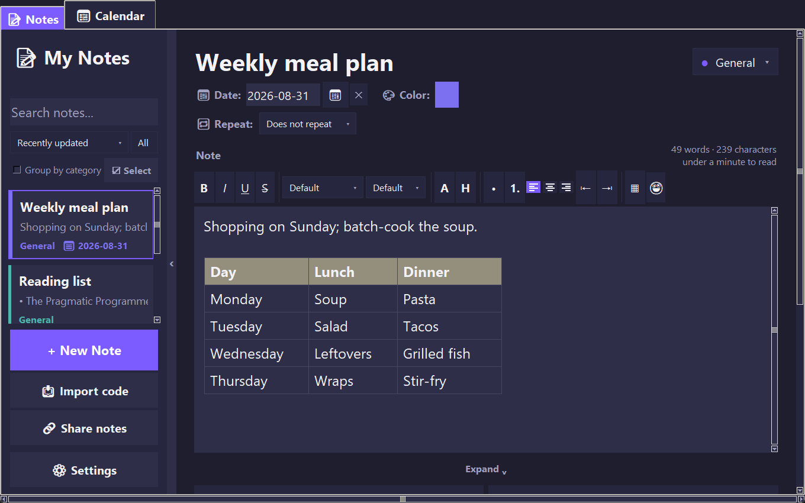
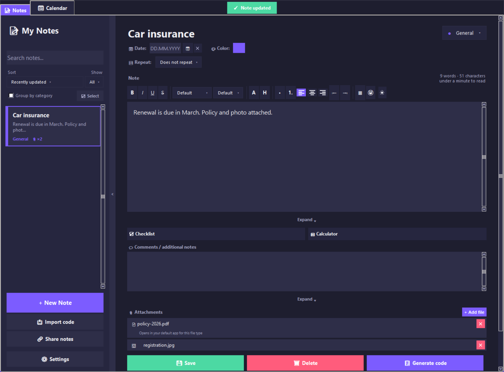
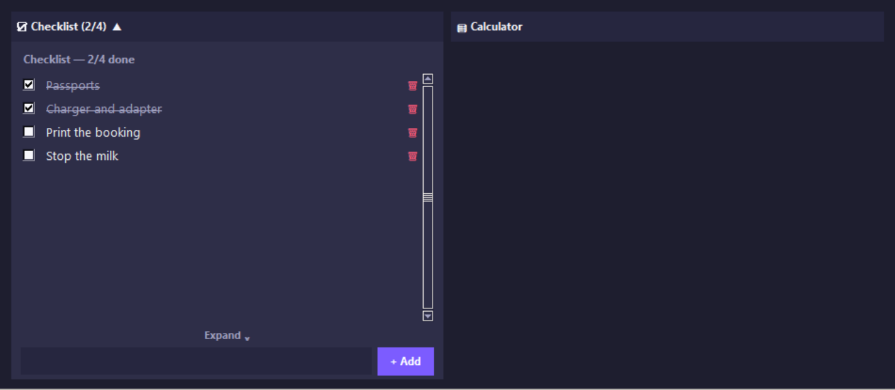
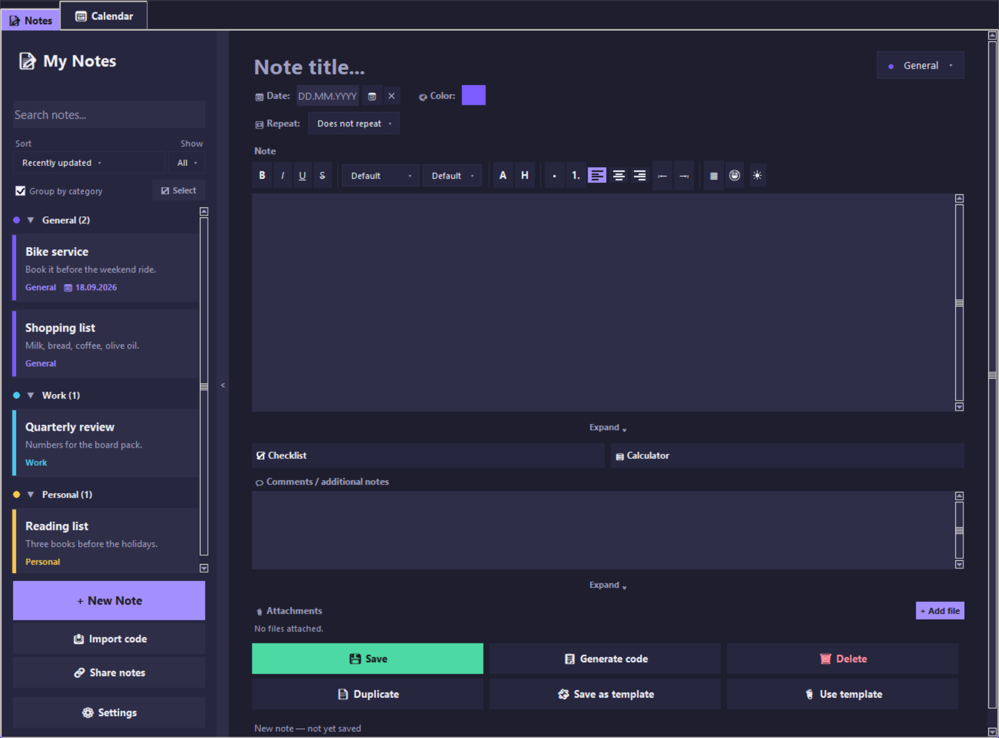
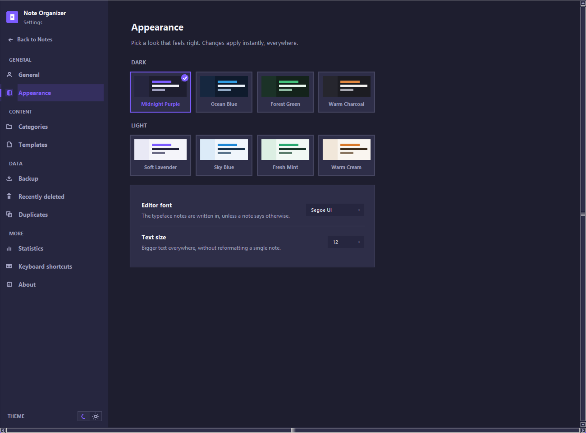

# User Guide

[← Back to the README](../README.md)

A full walkthrough of Note Organizer — what it does, and how to use it, with a screenshot for
every major feature.

## Contents

- [Getting started](#getting-started)
- [Notes](#notes)
  - [Creating and editing](#creating-and-editing)
  - [Formatting](#formatting)
  - [Pasting and copying](#pasting-and-copying)
  - [Tables](#tables)
  - [Attachments](#attachments)
  - [Checklists](#checklists)
  - [Calculator](#calculator)
  - [Emoji](#emoji)
  - [How long a note takes to read](#how-long-a-note-takes-to-read)
  - [Finding notes: search, sort, and grouping](#finding-notes-search-sort-and-grouping)
  - [Organizing](#organizing)
  - [Templates](#templates)
  - [Undoing a delete](#undoing-a-delete)
  - [Trash](#trash)
  - [Finding & cleaning up duplicates](#finding--cleaning-up-duplicates)
- [Recurring notes](#recurring-notes)
- [Calendar](#calendar)
- [Sharing & backup](#sharing--backup)
  - [Share a note as a code](#share-a-note-as-a-code)
  - [Import a code](#import-a-code)
  - [Export one note as a file](#export-one-note-as-a-file)
  - [Full backup: export](#full-backup-export)
  - [Full backup: import](#full-backup-import)
  - [If the data file itself ever breaks](#if-the-data-file-itself-ever-breaks)
- [Settings](#settings)
  - [Your name](#your-name)
  - [Statistics](#statistics)
  - [Keyboard shortcuts](#keyboard-shortcuts)
  - [Appearance](#appearance)

---

## Getting started

Note Organizer runs as a single window with two tabs, **Notes** and **Calendar**, plus a
**Settings** page reached via its own button at the bottom of the sidebar. Everything is stored
locally on your own computer — there's no account to create and no internet connection required.
Run from source, the data folder sits next to the script; the installed app keeps it per-user
under `%APPDATA%\NoteOrganizer` (worth knowing if you ever go looking for your notes folder).

The window can be made as small as 640 by 600 pixels. While you drag its edge, the page inside
keeps its size — cut off at the edge, or with an empty strip beside it — and settles to fit the
moment you pause or let go. Laying the whole page out at every step of the drag is what made
the edge lag behind the mouse.

---

## Notes

### Creating and editing

Click **+ New Note** in the sidebar to open a blank editor. A note has a title, a body, optional
comments, a category, an optional date, an optional colour, and an optional checklist. There's only
ever one editor open at a time — clicking a different note in the list automatically saves
whatever you were working on first, so there's no tab-juggling and no risk of losing an edit.

Notes save automatically a moment after you stop typing (look for the "Auto-saved" status), and
always save immediately when you switch to a different note. There is a safety net under the
autosave, too: if a note's text suddenly shrinks drastically (an accidental select-all-and-type,
say), the app quietly keeps the earlier version and an **↩ Restore previous** button appears in
the editor — one click (past a warning that pre-selects No) brings the old text back whole,
tables redrawn and all.

Closing the app works the same way:
anything still unsaved is saved on the way out, silently — no "unsaved changes" question, because
there is nothing to lose.

The one exception is editing a single day of a repeating note (opened from the calendar): saving
that needs an answer — "this occurrence or the whole series?" — and the app never asks questions
on its own while you type. Your edits wait in the editor, and the question comes when *you* act:
pressing Save, switching notes, or closing the app. Answer it and the edit is saved where you
chose; cancel it and the edit stays only as long as you stay on that view.

The writing area starts at twelve lines. **Expand**, underneath it, makes it roughly twice as tall
for a long note, and **Collapse** puts it back — the note itself is unaffected either way, only
how much of it you can see at once. The buttons at the bottom of the editor do not go out of
reach; the page simply gets longer and scrolls. The app remembers which you chose. The comments
box has the same toggle and remembers it too, so a box you expanded stays expanded next time.
Comments are plain text only — pasting a
table there keeps the words and drops the table (tables live in the body, which draws them as a
real grid), with a brief note telling you it happened.

For the quick light/dark switch at the end of the formatting toolbar, see
[Appearance](#appearance).

### Formatting

A small toolbar above the note body is split into four groups, separated by thin dividers. If the
window is too narrow to hold them all on one line, the toolbar wraps onto a second rather than
hiding anything.

- The first three — the style toggles, the font dropdowns, and the two colour buttons — change the
  characters you select. The last changes whole lines.
- Hover any button and it tells you what it does.
- **Style**: **Bold**, *Italic*, <u>Underline</u>, and ~~Strikethrough~~ — also on the right-click
  menu, and available as keyboard shortcuts (**Ctrl+B**, **Ctrl+I**, **Ctrl+U**, **Ctrl+D**).
- **Colours**: text colour and highlight, each opening a small swatch picker (no hex codes to type —
  just pick a colour) with a Clear option to remove it again.
- All six work the same way: select some text and click (or press) one to apply it there, or click
  one with nothing selected — it "sticks" for whatever you type next, until you click it again to
  turn it off.
- Text colour and highlight can be combined with each other and with any of the four styles.

**Paragraph** applies to whole lines — whichever lines your cursor or selection touches, so you
don't need to select a line exactly.

- **Lists.** The **•** and **1.** buttons turn those lines into a bullet or numbered list. Click
  the same button again to turn the list off. Press **Enter** to start the next item; press it on
  an item you haven't typed anything into and the list ends there. **Backspace** with the cursor
  just after a marker removes the marker rather than deleting it one character at a time.
- **Nesting.** **Tab** pushes a list item one level in, **Shift+Tab** pulls it back out — or use
  the **⇤** and **⇥** buttons. A numbered sub-list counts from 1 again under each parent, and
  picks the outer numbering back up when it ends. Bullets change shape as they go deeper
  (•, ◦, ▪). Outside a list, Tab still types a tab; the two indent buttons work on any paragraph,
  list or not, up to eight levels.
- **Alignment.** The three bar icons set a line left, centred, or right. Clicking the alignment a
  line already has puts it back to left.

These combine: a bullet can be centred, an indented paragraph can be right-aligned, and any of it
can carry bold or a text colour.

List markers are part of the note's own text — a bullet really is a "• " at the start of the line.

*Why: it means a list still looks like a list when you export the note, share it as a code, or
paste it into an email.*

The indenting is drawn by the app on top of that.

**Font** sets the typeface and size. Pick from either dropdown to change the selected text, or
pick with nothing selected and it applies to whatever you type next — the same way the Style
buttons work.

- **Default** means "no setting of its own", so that text follows whatever the editor's default
  is. It is how you undo a size or a typeface, rather than setting it back by hand.
- If you select text that mixes two sizes, the dropdown shows **Default** rather than picking one
  of them.

  *Why: otherwise it would look like the whole selection was already that size.*

- The eight typefaces are ones that come with Windows.

  *Why: if a note used a font the person you send it to doesn't have, their computer would quietly
  swap in a different one and nothing would say so.*

**To make everything bigger**, don't format each note — go to **Settings → Appearance** and set
**Editor font** and **Text size**. That is the size notes start at; anything you set from the
toolbar overrides it just for that text. This is the setting to reach for if the default is simply
too small to read comfortably.

A title can be up to 200 characters.

*Why: that is far more than a title needs, and it keeps the field quick to type in — a very long
one makes the box itself sluggish.*

You do not have to count: once you are within 40 characters of the limit, a small counter appears
beside the title (`175/200`) and turns red when it is full. Pasting something longer shortens it
to fit rather than refusing it. Titles saved before this limit existed are left exactly as they
are, however long they are.

### Pasting and copying

Copy something from a web page, an email or Word, paste it into a note with **Ctrl+V**, and the
bold, the colours and the lists come with it.

- **Ctrl+Shift+V** pastes the words on their own, with none of the styling — and no bullets
  either, even when the thing you copied from puts bullet characters into its own plain-text
  version. There is a **Paste without formatting** entry on the right-click menu too.
- Copying works the same way outwards: select part of a note, copy it, and paste it into an email
  or a document, and it arrives still formatted. Copying between two notes keeps everything.

Pasting from a PDF is a special case, because a PDF has no paragraphs — only lines placed on a
page. Pasting those as they come gives a note broken into narrow ragged lines a third of the way
across. They are rejoined instead, using where each line ends to work out which breaks the page
forced and which the writer meant: a line ending mid-sentence was broken by the column, a line
falling well short of the others ended on purpose, and an indented first line says outright where
a paragraph starts. It is worked out rather than known, so it is occasionally wrong — always by
joining two paragraphs into one, never by cutting a sentence in half. Lists, addresses and poems
are left exactly as they came.

Colours are treated carefully. If you copy from a site in dark mode, you get its words, its bold
and its lists — not its dark background and pale text, which would be unreadable in your note. A
colour comes through when it was clearly a choice, like a red warning or a yellow highlight;
greys, blacks and whites are the page's own styling and are left behind.

Not every kind of styling can survive. A note can be bold, italic, underlined, struck through,
coloured, highlighted, set in one of eight fonts, made into a list, indented and aligned. Anything
a web page does beyond that — a heading style, a box, a background image — is dropped and its
words kept, rather than being turned into an approximation of itself. Font sizes and typefaces
from a web page are dropped for the same reason.

*Why: the page is almost certainly using something this app does not offer, and picking the
nearest one would claim the note is set in something it never was.*

### Tables

The table button on the toolbar opens a small size grid — sweep across it to choose how many rows
and columns, and a table appears at the cursor with the first cell ready to type into. (Tables
start at two columns: a single-column row of pipes reads as ordinary text, not a table, so the
picker never offers one.)

A table works the way a spreadsheet has taught your hands to expect:

| Key | Inside a table |
| --- | --- |
| **Tab** | Moves to the next cell, and is one way to leave the cell you are typing in. On the very last cell it adds a fresh row, so a whole table can be filled without touching the mouse. |
| **Shift+Tab** | Goes back to the previous cell. |
| **Enter** (or **Shift+Enter**) | Starts a new line *inside* the cell — the whole row grows to fit, on screen the moment you press it, so nothing below is ever covered. Stored as Markdown's own ` `, so export still round-trips. |
| **Escape** | Leaves the cell (clicking anywhere else works too). |
| **Delete** | Clears the selected block of cells. |
| **Ctrl+A** | Selects the whole cell. |

- A table wider than the editor gets its own horizontal scrollbar, drawn just underneath it.
- **Click** any cell to edit it. **Drag** across cells to select a block of them — a firm drag
  *inside* one cell selects just that cell; drag toward an edge and the view scrolls along with
  you, so a selection can reach cells that started off screen — then **Ctrl+C** copies it and
  **Ctrl+V** somewhere else pastes it in the same shape.
- Copying works with the outside world in both directions: cells copied here paste into Excel as
  cells and into Word as a real table with visible borders, and a table copied from Excel or a web
  page lands here as a real table.
- **Right-click** a cell for everything else — the everyday actions sit on top, and **Align cell /
  Rows / Columns / Merge / Table** each hold their group one hover away.
- Under **Table** lives **Add caption below…**: a centred, auto-numbered "Table N: description"
  label (typing replaces the selected placeholder) plus a "Source:" line for links and sources —
  plain, editable body text ever after, so the wording is yours to change.
- The full set: merge the selected cells into one (their texts join), split a merge back apart,
  insert or delete rows and columns, duplicate whole columns to the end of the table (and whole
  rows to the bottom), insert a **checkbox** (with its own colour palette) or an emoji, and
  highlight cells from a small colour palette.
- A checkbox is a real little box, not text: **click it to tick and untick it** — for marking when
  a row's condition is met, a habit done, anything you invent. It is stored as Markdown's own task
  syntax (`[ ]` / `[x]`), so it survives share codes as readable text; the exported page draws it
  as a real box (☑ / ☐), and importing that page back turns the boxes into clickable checkboxes
  again. To turn that cell back into words, right-click it and choose **Edit cell as text**,
  delete the marker, and type.
- **Drag the line between two columns** to make a column wider or narrower; **double-click** the
  line to snap the column to its content. With several columns selected, **Autofit column
  width(s)** in the right-click menu snaps them all at once. **Drag the line between two rows** up
  or down to make a row taller or shorter — the whole row resizes together, and a drag can never
  cut into text a cell actually holds. Narrowing below the content only shortens what is *drawn*
  (with an `…`) — the text itself is never cut.
- **Hide a column** by selecting it top to bottom and right-clicking — it shrinks to a thin
  sliver, and right-clicking the sliver brings it back. Hiding only ever works on a fully selected
  column, so it is always clear what is about to disappear. A hidden column stays hidden in the
  exported page and in cells copied to Word, too — the data itself never leaves the note, so
  unhiding brings it straight back.
- **Ctrl+Z understands tables**: one undo takes back one whole operation — a cell edit, a resize,
  a fill, a dropped checkbox — never half of one, and the drawn table follows the text every step.
- The **formatting toolbar works inside tables** too: select cells and Bold, colours and
  highlights apply to them whole.
- With a cell *open*, the toolbar styles just the part you selected inside it — a single word,
  letter, or emoji can carry its own colour — and the open cell shows its colours while you edit,
  not after. Typing continues the style it lands beside: adding to a blue word stays blue.
- Pick a colour with nothing selected and it becomes the *active* colour — the toolbar button
  wears it as a swatch so you can see what you are writing with — and everything you type next, in
  a cell or in the note body, comes out in that colour until you pick another or click the same
  colour off.
- The alignment buttons align the text inside the selected cells; to move the *table itself*,
  right-click it and choose **Center table on page** (or left / right).

Under the hood a table is stored as plain, readable text inside the note — the same pipe-and-dash
layout Markdown uses.

*Why: search finds words inside cells, tables survive share codes, backups and export unchanged,
and a table pasted into any Markdown-aware tool arrives as a table.*

Search and the word count read a table the way you do: the pipes, dashes and markers themselves
are invisible to both, so searching "---" matches nothing and an empty table counts no words. The
bullet and numbering buttons deliberately do nothing to a table.

*Why: a table is not a list, and turning its rows into list items would break it apart.*

### Attachments

Attach one or more files to a note from the editor. Attached files show as a small list with their
name and a way to remove them; click a file to open it. Removing an attachment deletes it from
that note only — it doesn't touch anything else.

### Checklists

Any note can have a checklist. Click **☑ Checklist** in the editor to open it, add items, and
check them off as you go — the note's card in the list shows progress at a glance (e.g. "☑ 2/5").
The box sits beside the calculator at the same size; when a list gets long, **⤢ Expand** in its
header grows it to give more room (and it always scrolls, expanded or not). The expanded size is a
per-view choice — switching notes returns it to the compact size.

### Calculator

Click **🧮 Calculator** in the editor, next to Checklist, for a collapsible built-in calculator —
standard arithmetic with real operator precedence, three interchangeable bracket styles, a square
root, powers, and percent, either from the on-screen buttons or by typing/pasting an expression
directly. Press **=** to see the result, then **Insert into note** to drop the whole formula (not
just the answer) into the note body — repeated inserts stack cleanly below each other. A
collapsible history keeps every calculation from the session, with a Clear button and
click-to-insert on any past entry.

### Emoji

Any text field in a note (title, body, comments) can have an emoji inserted at the cursor via the
right-click menu, without leaving the keyboard to hunt through the system emoji picker.

### How long a note takes to read

Under the word and character counts, each note shows roughly how long it takes to read — "under a
minute to read" for a short one, "about 4 minutes to read" for a longer one.

It is worked out from the word count at 200 words a minute, which is the slow end of normal adult
reading.

*Why: finishing sooner than promised costs you nothing, whereas being told a note is shorter than
it really is does.*

### Finding notes: search, sort, and grouping

Search the note list by keyword, and sort by recency, title, category, or date, from the controls
above the list. This is the search for finding *which* note you want, across the whole notebook.
An **✕** appears inside the search box once you have typed something; it empties the box and puts
the whole list straight back. Right-clicking the box offers Cut / Copy / Paste, like every other
text field in the app.

Two dropdowns sit under the box, each with its own caption so you can tell at a glance which is
which. **Sort** offers seven orders — Recently updated, Oldest updated, Title A–Z, Title Z–A,
Category, Calendar: soonest, Calendar: oldest. **Show** narrows the list instead of reordering it:
all your categories, plus **🔁 Repeating** and **📅 Dated** for the notes that live on the
calendar. Both are remembered, so the list you left is the list you come back to; if the category
a filter names is later deleted, the filter falls back to **All** rather than showing you nothing.

A long list fills in as you scroll: the app draws the first screenful straight away and the next
notes as you come near them, by wheel, scrollbar or the arrow keys, so the scrollbar's handle
shrinks a little as you go. Every note is there, in order; searching, **Select all** and the
counts beside the category headers always mean the whole list, drawn yet or not.

*Why: a notebook of hundreds of notes used to make you wait for every one of them to be drawn —
at startup, at every pause in typing, and every time you came back to the list.*

To search *within* the note you already have open, press **Ctrl+F**. A small find bar appears in
the top-right corner of the editor — inside the window, not a separate dialog. It looks through
the note's text and its tables: type a word and every match highlights, with the current one
picked out; **Enter** and **Shift+Enter** step forward and back (wrapping around at the ends), the
count reads "3/12", and **Aa** switches on case-sensitivity. A match inside a table scrolls the
table into view and outlines the cell it's in. Find only highlights — it never changes the note —
and **Esc** or the **✕** closes the bar.

Each note's card previews its first words. A table would be pipe soup at that size, so the preview
shows only the note's plain text and the card's tag row marks the table itself — **▦ 1 table**, or
how many the note holds — next to the comment and attachment marks.

The list can be worked without a mouse. Click a note, or **Tab** into the list, and the card gets
a visible ring; **↑** and **↓** walk from card to card in the order they are actually shown —
sorted, filtered, searched or grouped as you left them, not the order they sit in the file — and
the list scrolls along to keep the ring in view. **Enter** (or **Space**) opens the note, and
**Shift+F10** — or the menu key, if your keyboard has one — opens that note's own right-click
menu where the note is, so pinning, duplicating, exporting and deleting are all reachable without
leaving the keyboard. The whole list is one **Tab** stop: Tab again moves on to the next thing in
the window instead of through every card. If the list rebuilds underneath you, because a save
landed or a search keystroke filtered it, the ring comes back to the card you were on.

The ring is drawn in the text colour while the keyboard is on the list, and the note you have open
keeps its accent-coloured outline — so after walking away from the open note you can see both.

**Group by category** (checkbox above the note list) clusters the list under collapsible category
headers instead of one flat list — click a group's header to collapse or expand it; the state is
remembered.

### Organizing

- **Pin** a note (right-click → Pin to top) to keep it at the top of the list regardless of sort
  order.
- **Duplicate** a note to create an editable copy, titled "(copy)". The copy owns its own
  copies of any attached files, so the two notes can be edited — or deleted — independently.
- **Move a note to another category** from its own right-click menu (**🗂 Move to category**),
  without opening it — the same list of categories the editor offers.
- **Categories** act as folders — create, rename, recolour, or delete them from Settings →
  Categories. Deleting a category with notes in it asks where to move them first; nothing is ever
  silently lost. A name can be up to 80 characters, and you can have up to 200 categories. If the
  settings file is ever lost, the categories your notes are filed under come back on the next
  start, with default colours, and the app says which ones.

#### Several notes at once

Turn on **☑ Select** above the list and every card grows a tick box. **Select all** ticks exactly
what the list is showing — never a note the current search or filter is hiding — and its label
flips to **Unselect all** once everything on screen is ticked.

The bar below then acts on what you ticked: **🗑 Trash**, **🗂 Category ▾**, **Export ▾**, and
**📌 Pin** — which reads **📌 Unpin** when everything you ticked is already pinned, so one button
covers both directions. Moving a batch to another category asks first and offers a way back, each
note to the category it actually came from; trashing a batch is undoable from the banner, and the
notes sit in the Trash besides.

### Templates

Save any note as a reusable template (📋 **Save as template**), or build one from scratch in
Settings → Templates. Starting a new note with **Use template** fills in the title, body,
category, and checklist from the template — the template itself is never affected by what you do
with the note afterward. Templates don't go to the Trash (Settings → Recently deleted) —
deleting one can't be undone, and the confirmation warns you and pre-selects **No**, like every
irreversible confirmation in the app.

### Undoing a delete

Right after you delete something, the banner at the top of the window carries an **Undo**
next to it. One click puts the note back and opens it, so you don't have to know the Trash
exists to change your mind. It works the same after deleting several notes at once — all of
them come back.

The banner stays for eight seconds, which is long enough to read it and decide. After that
it fades, and the note is still in the Trash below.

Undo is the **only** way back for one other thing: removing a single day from a repeating
note. That day is not kept anywhere you can reach — so if the banner has gone, the way to
bring the day back is to set the repeat up again.

### Trash

Deleting a note moves it to the Trash — **Recently deleted**, in Settings — where it's recoverable for 30 days
before being purged automatically — or for however long you choose: a **Keep deleted notes for**
selector at the top of the same panel offers 7 to 90 days, and a change applies from the next
startup's cleanup. Restore individual notes, delete them permanently one at a time, or empty the
whole trash at once. With a lot of deleted notes, the list loads the most recent batch first, with
a button to reveal more — so it stays quick to open no matter how much has accumulated there.

Each row also carries a tick box, so getting a batch back is one gesture rather than forty: tick
what you want and an **↩ Restore N selected** button appears at the foot of the panel, just above
**Empty trash**, counting what you ticked. It is only there while something is ticked — and it is
deliberately the quieter of the two, because the sweeping button beside it is the irreversible one.

Two deleted notes with the same title used to be impossible to tell apart, which made restoring
both the only safe choice. Hovering a row now floats a small preview of that note's contents
beside it — it appears on hover and goes when you move away, nothing to click and nothing to close.

### Finding & cleaning up duplicates

Settings → **Duplicates** groups notes that match on title, body, comments, and category. Within a
group, tick specific copies to remove (the rest are kept — nothing forces "keep exactly one"), or
use **Clean up ALL groups** to apply "keep the first, remove the rest" across every group in one
click.

---

## Recurring notes

Any note can repeat. Open the **Repeat** section in the editor and choose:

- **Daily**, with a custom interval (every N days)
- **Weekly**, on specific weekdays
- **Monthly**, on specific days of the month — with a choice of what happens in shorter months
  (e.g. a note set for "the 31st": either land on that month's *last* day, or be *skipped*
  entirely that month)
- **Yearly**, on a specific date

Set an end condition if the note shouldn't repeat forever: after a number of occurrences, or by a
specific date.

Editing or deleting one specific occurrence (rather than the whole series) is always offered as a
separate choice — your edit only applies where you meant it to. Leaving a day you have edited —
opening another note, starting a new one, or closing the window — asks where the edit belongs
first, and **Cancel** keeps you on that day with the edit still on screen, unsaved.

A day you edited with **"only this occurrence"** keeps its own content from then on: later edits
to the series deliberately do not touch it (that day is *yours*), which can look surprising — a
series edit appears everywhere except there. The app now says this out loud wherever it matters:
the editor shows a line above the title — "🔁 This note repeats — edits here apply to every day ·
1 day keeps its own edits (✎)" — and in the calendar, such a day carries a ✎ mark in the day list
and an "✎ edited for this day" chip in the preview. To make a day follow the series again,
right-click it in the calendar and choose **↺ Reset this day to the series content**.

The small symbols on a repeating note's card in the list mean: `✎N` — N days edited separately,
`✕N` — N occurrences deleted individually. The sidebar's filter dropdown also offers
**🔁 Repeating** and **📅 Dated** alongside your categories, to see just the notes that live on
the calendar — and the sort dropdown speaks calendar too: **Calendar: soonest** ranks notes by
their next relevant date from today (a repeating series by its next occurrence, upcoming dates
first, undated notes last — a mini-agenda), while **Calendar: oldest** walks the archive in plain
chronological order by each note's own date.

---

## Calendar

The Calendar tab shows every note (including every occurrence of every recurring note) on the day
it falls on. Navigate month-to-month, jump directly to a specific month/year, or return to today.
Multiple notes on one day show up to two title previews plus a "+N more" indicator; hovering a day
gives a quick summary of everything on it, while hovering one title shows just that note.

Those titles are the notes themselves, and behave like them: **click** a title to land on that
note's preview, and **right-click** it for that note's own menu — open, pin, duplicate, export,
delete. Right-clicking anywhere else in the cell, or on the day number, still gives the menu for
the *day* (colour, markers, add a note here), so the two are never confused.

Clicking a note in the day panel opens a **quick-look preview** — the note's plain text, plus a
line of small flags saying what else it carries (▦ a table, ☑ a checklist, 💬 comments). Like the
note-list cards, the preview does not draw the table or spell out the checklist and comments;
those show when you open the note in the editor (**✏ Open in editor**).

Opening a note from the calendar — the panel's Edit button or any right-click edit entry —
remembers where you came from: a **← Back to Calendar** link appears at the top of the editor and
returns you to that exact month and day, saving your edits on the way (for one day of a repeating
note, it asks the usual "this occurrence or the whole series?" first — cancel that question and
you simply stay in the editor, nothing lost). While you're editing one
day of a repeating note, a line above the title names that day — the date field always shows the
series' start date, so this is what tells you *which* day you opened. Saving stays in the editor;
only the quick "Add note for this day" flow returns you to the calendar on Save.

Clicking a day also draws a thin accent frame around it for as long as its panel is open — so a
glance always shows where you are. Today keeps its own permanent accent bar at the top of its
cell, whichever day you're looking at.

**📋 History**, at the far right of the calendar's header, is the register of everything that
ever lived on the calendar: dated notes at their date, and each repeating note as a group. The
button is a toggle — it reads "📋 History" on the calendar and "📅 Calendar" while the register
is open, so it always says where it will take you; switching tabs and coming back returns you to
the calendar grid. A
short series ("10 times", or one that ends soon) opens to **all** its days, with ✎ marking the
ones edited separately; an endless one lists just its ✎ days (every other day shows the series
content — a note in the group says so), and a series with nothing to unfold shows a → and takes
you straight to its day on the calendar. It has its own search — one that also looks *inside* what you
wrote on those individual days, which the sidebar search cannot see — and year buttons
(All / This year / Last year / 2 years ago / Older) for digging through the archive. Click any entry
and you land back on that exact day's preview; right-click gives the usual day menu, including
"Reset this day". Handy when you know a meeting happened *sometime* and only remember a word of
what was discussed.

You can also mark the day itself, independent of any note on it — right-click a day for both:

- **🎨 Color this day…** paints it a custom colour, useful for a holiday, a deadline, or a week
  you want to see at a glance.
- **🏷 Mark this day…** puts emoji on it — a birthday, a trip, a payday. **Up to three**, and the
  picker says so: once you have three, the ones you have not picked go flat and a line reads
  "Three is the most a day can show — unpick one to choose another", rather than the fourth click
  simply doing nothing. The day's cell shows them as a small badge in the corner.

Both can be cleared from the same menu, and both clears offer an **Undo** in the banner.

---

## Sharing & backup

### Share a note as a code

Open a note → Generate code. This generates a compact block of text representing that note's
content, checklist included (attachments stay home — the full backup is what carries files) — paste it to someone
else, and they can import it with **Import code** in the sidebar. Either way the code area carries
an **✕** to put it away once you have copied it.

To put several notes in one code, use **🔗 Share notes** in the sidebar: a tick box per note, with
**Select all** above the list. It ticks the notes the panel is actually *showing* — with a long
notebook the list arrives a hundred at a time, and a button that silently ticked notes you had
never seen would be the opposite of the control you asked for. Reveal more and press it again; its
label reads **Unselect all** once everything on screen is ticked.

### Import a code

Paste a code you received into **Import code** in the sidebar. If any of the notes it contains
look identical to ones you already have, you'll be asked whether to skip the duplicates, import
everything anyway, or cancel — nothing is silently duplicated.

#### When the code holds a note you already have

A code carries the note's identity, not just its words — so a note of yours that went out as a
code and comes back, edited, is recognised as **that note** rather than treated as a stranger.
When that happens you are asked:

> **Same note, a different version**
> Updating replaces what is on this device; you can undo it with "↩ Restore previous".
> Adding leaves both, so you can compare them and delete one.

- **Update this note** replaces its title, text, styling, comments, category, date, colour,
  repeat rule and checklist with the version from the code. It stays the same note in the same
  place, keeps its attachments, and keeps the date it was created. If it was a mistake, the
  editor's **↩ Restore previous** puts all of it back — the ticks in the checklist included,
  not only the words.
- **Add as a new note** leaves both, so you can read them side by side and delete whichever you
  don't want. The copy is a note in its own right from then on — editing it never touches the
  original.

A code holding several notes asks once, and your answer covers all the ones it recognises; notes
in it that are genuinely new are added either way.

The identity is given to every note the first time the app reads it, and written down there and
then — nothing to run, nothing to decide, and nothing about your notes changes.

### Export one note as a file

Right-click any note in the list (or on the calendar) → **Export as file** and pick a format — the
menu says plainly what each one keeps:

- **Web page (.html)** — the complete note: styles, colours, highlights, and tables as real
  tables. It opens in any browser (press **Ctrl+P** there and "Save as PDF" to get a PDF) and Word
  opens it directly too (then Save As → .docx if you need one).
- **Plain text (.txt)** — the words alone.

The note's checklist and comments come along too, as their own sections, and a table centred (or
right-placed) in the note keeps its place on the exported page. When you print the page to PDF,
highlights and cell colours survive — the export tells the browser to keep them. After a save the
app offers to open the file right away — the exported file itself is the honest preview of how the
note lays out on a page, so adjusting the note and re-exporting is a quick loop. To export
**several notes at once**, turn on ☑ Select above the list, tick the notes (or hit **Select
all**, which selects exactly what the current search and filter show — never a note the list is
hiding), and use **Export ▾**
in the action bar: pick a format and a folder, and each note becomes its own file (same-titled
notes get “(2)”, “(3)” — nothing ever overwrites). Attached files never travel with a single-note
export — that's what the full backup below is for, and the app reminds you when the note has
attachments.

### Full backup: export

Settings → Export notes creates a single `.zip` containing every note, your settings, every
attachment, your templates and the Trash — the one file that moves *everything* to another
device. A line under the button
remembers when you last did this — worth a glance now and then, because that `.zip` is the only
copy of your notes outside the app's data folder (see Getting started for where that lives). With a lot of attachments this can take a moment;
a progress bar stays visible at the bottom of the window the whole time, and the app remains fully
usable while it works. Two quiet guarantees ride along: a new export can never damage the
previous backup file (the zip is written beside it and swapped in only when whole), and closing
the app mid-export waits for the file to finish instead of cutting it off.

### Full backup: import

Settings → Import notes brings a previously exported `.zip` back in — notes, settings,
attachments, templates and the Trash together. Just like importing a code, you'll be asked
about any notes that look identical to what you already have before anything is added; a
template only comes in if you don't already have one by that name, and re-importing the same
backup never doubles the Trash.

A note the backup holds that you **already have** — edited on the other device since — is
recognised as that note, and you're asked once whether to update yours or keep both. An update
brings everything the backup's copy carries: its text and checklist, its skipped days and
per-day edits, its pin, and any files attached on the other device. Files already attached here
stay attached; an update only ever adds them. **↩ Restore previous** takes the rest back.

### If the data file itself ever breaks

A bad shutdown or a disk problem can leave `notes_data.json` unreadable. The app never papers
over that: it preserves the unreadable file beside the original (named
`notes_data_corrupt_<date>.json`, kept forever), starts with an empty list, and tells you at
startup exactly what happened and where the preserved copy sits — so you can restore your most
recent backup while the broken file stays available for repair. The same quiet preserve-aside
protects the trash, templates and settings files.

Failed *saves* speak up too: if a data file can't be written (a read-only folder, a full disk),
an error message names the file instead of pretending the save worked, and a technical trace
lands in `crash_log.txt` beside your data — worth attaching if you ever report a problem.

---

## Settings

Categories, templates, trash, duplicate cleanup, appearance, your name, usage statistics, and a
keyboard-shortcut reference all live on one page, reached via the **⚙ Settings** button at the
bottom of the sidebar. The page is split in two: a list of settings on the left, and whichever one
you picked on the right. One section shows at a time, so you're only ever looking at the setting
you came for. A **← Back to Notes** button at the top returns you to your notes.

### Your name

Settings → Your name sets the greeting shown above the note list ("Hi \<name\>,"). Leave it blank
for no greeting.

### Statistics

A quick snapshot of your total note count and this week's activity, with a clickable chip per
category — click one to jump straight to your notes filtered to that category.

### Keyboard shortcuts

Three shortcuts work from anywhere in the app: **Ctrl+N** starts a new note, **Ctrl+S** saves the
note you're editing, and **Ctrl+F** opens the find bar for searching within the current note (see
*Finding notes*, above). From the Settings page, Ctrl+N and Ctrl+F take you back to the editor
first (asking about a template you were halfway through). While a question is on screen, the
shortcuts wait for your answer. Settings → Keyboard shortcuts carries this reference inside the app,
grouped by where each combo works. The table below is the longer of the two — it also covers the
keys that only mean something inside a list, in the find bar, or on the note list.

| Shortcut | Where | What it does |
| --- | --- | --- |
| **Ctrl+N** | anywhere | Starts a new note. |
| **Ctrl+S** | anywhere | Saves the note you're editing. |
| **Ctrl+F** | anywhere | Opens the find bar for searching within the current note. |
| **Ctrl+B** / **Ctrl+I** / **Ctrl+U** / **Ctrl+D** | editor | Bold / Italic / Underline / Strikethrough. |
| **Ctrl+V** | editor | Pastes — the bold, the colours and the lists come with it. |
| **Ctrl+Shift+V** | editor | Pastes the words on their own, with none of the styling. |
| **Ctrl+Z** | editor | Undoes, in the note body and in comments. |
| **Ctrl+Y** / **Ctrl+Shift+Z** | editor | Redoes. |
| **Enter** | in a list | Starts the next item; on an item you haven't typed anything into, the list ends there. |
| **Backspace** | in a list | With the cursor just after a marker, removes the marker. |
| **Tab** / **Shift+Tab** | in a list | Pushes an item one level in / pulls it back out. |
| **Tab** / **Shift+Tab** | in a table | Moves to the next / previous cell; Tab on the very last cell adds a fresh row. |
| **Enter** / **Shift+Enter** | in a table | Starts a new line inside the cell. |
| **Escape** | in a table | Leaves the cell. |
| **Ctrl+A** | in a table | Selects the whole cell. |
| **Ctrl+C** / **Ctrl+V** | in a table | Copies the selected cells / pastes them in the same shape. |
| **Delete** | in a table | Clears the selected cells. |
| **Ctrl+Z** | in a table | Takes back one whole operation. |
| **Enter** / **Shift+Enter** | find bar | Step forward and back through matches. |
| **Esc** | find bar | Closes the bar. |
| **↑** / **↓** | note list | Walks from card to card, in the order the list is showing them — also straight after a click on a note. |
| **Enter** / **Space** | note list | Opens the note — or ticks it, while ☑ Select is on. |
| **Shift+F10** or the menu key | note list | Opens that note's own right-click menu, at the note. |
| **Page Up** / **Page Down** | Calendar tab | Previous / next month. |
| **Ctrl+Page Up** / **Ctrl+Page Down** | Calendar tab | Previous / next year. |
| **Home** | Calendar tab | Jumps back to today. |

### Appearance

Switch between Dark and Light mode, and pick from four variants of each, in Settings → Appearance.
The choice is remembered the next time you open the app.

At the end of the formatting toolbar sits a small **light/dark switch** (☀ / 🌙): one press flips
between your last light and last dark theme without leaving the note. The full theme picker, with
all eight variants, stays in **Settings → Appearance**.

---

**What changed recently:** see the [CHANGELOG](../CHANGELOG.md).
