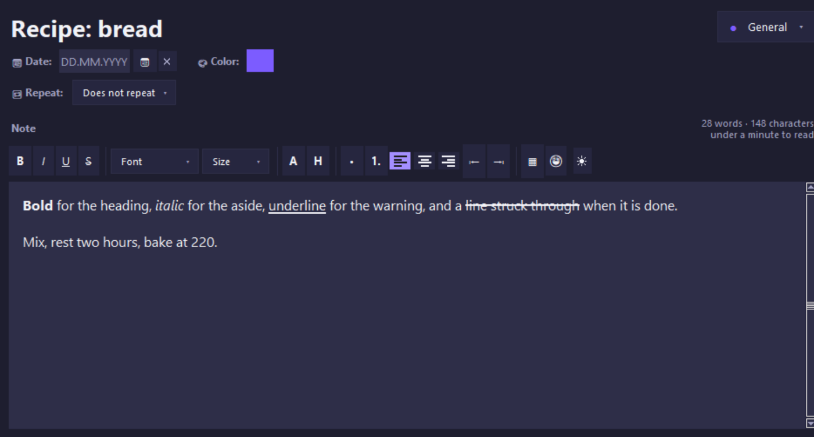
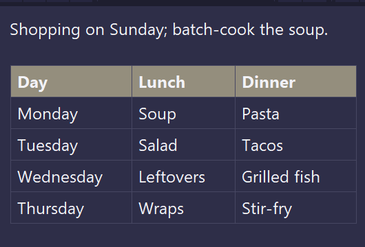
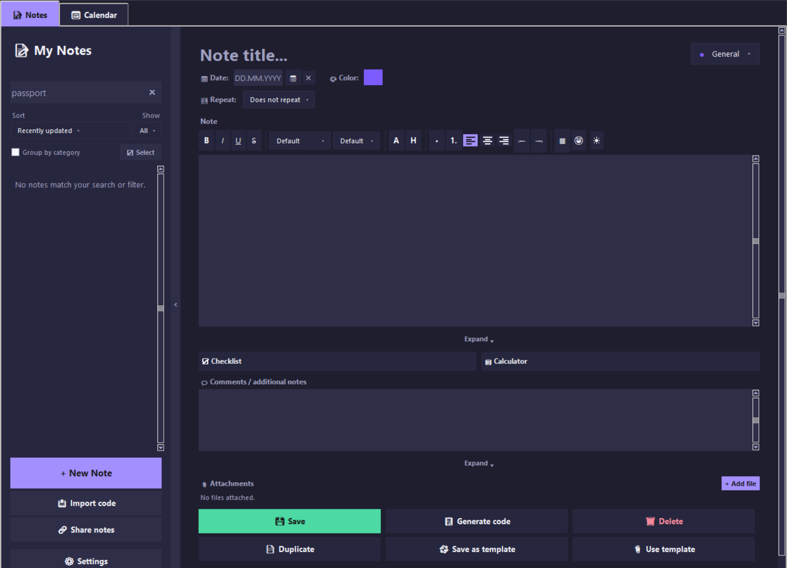
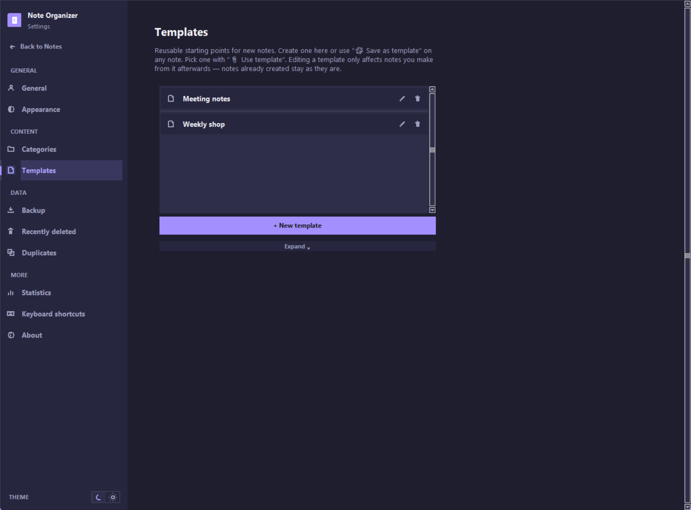
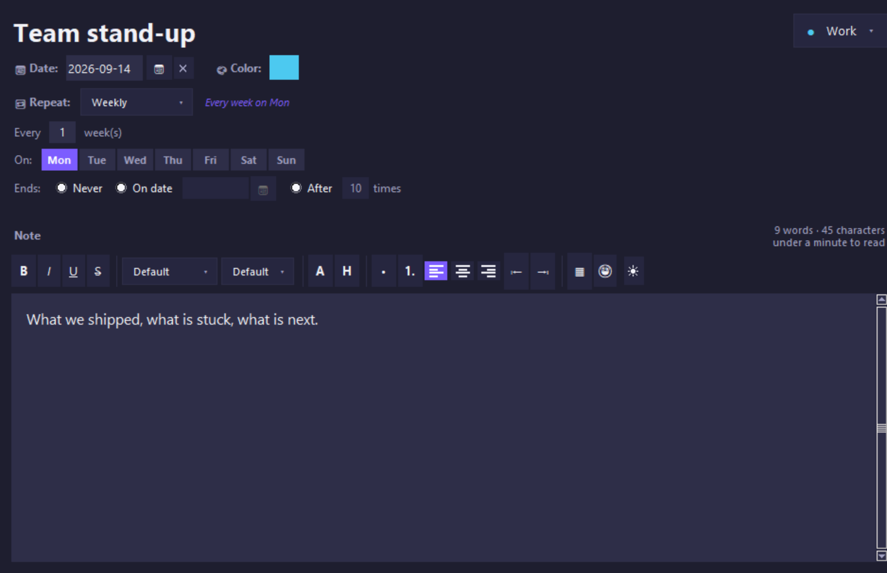
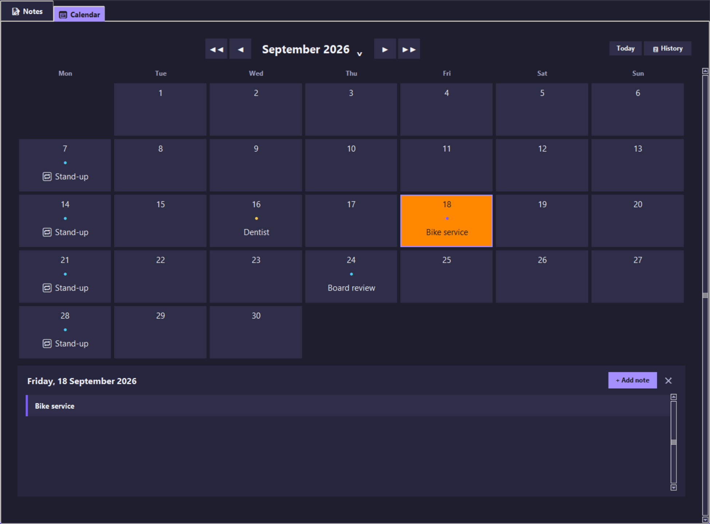
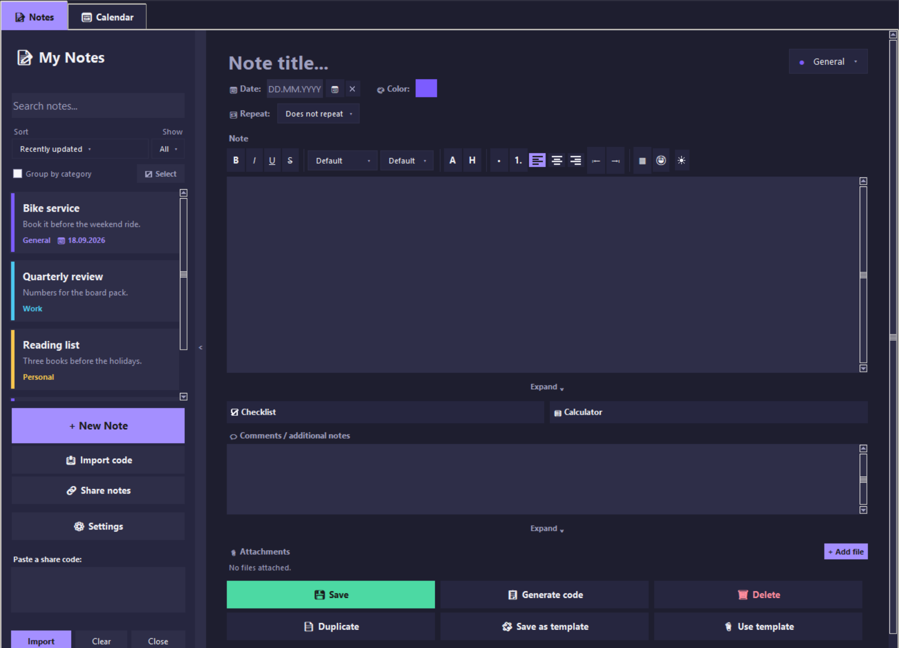
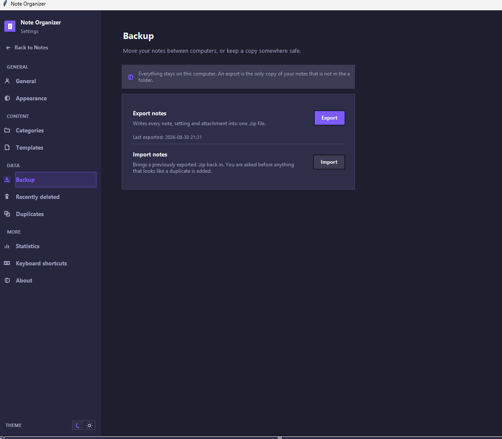
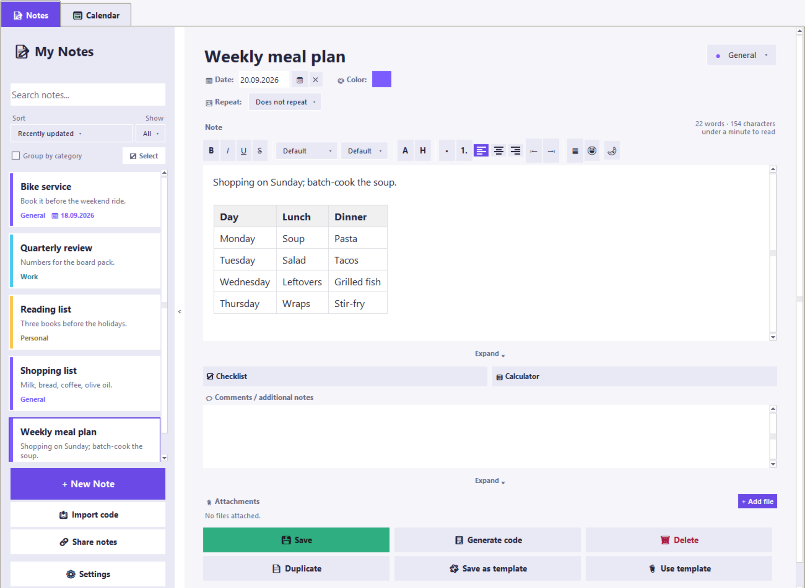

# User Guide

[← Back to the README](../README.md)

A full walkthrough of Note Organizer — what it does, and how to use it, with a screenshot for
every major feature.

## Contents

- [Getting started](#getting-started)
- [Notes](#notes)
  - [Creating and editing](#creating-and-editing)
  - [Writing a date](#writing-a-date)
  - [Formatting](#formatting)
  - [Pasting and copying](#pasting-and-copying)
  - [Tables](#tables)
  - [Attachments](#attachments)
  - [Checklists](#checklists)
  - [Calculator](#calculator)
  - [Emoji](#emoji)
  - [How long a note takes to read](#how-long-a-note-takes-to-read)
  - [Spelling](#spelling)
  - [Finding notes: search, sort, and grouping](#finding-notes-search-sort-and-grouping)
  - [Organizing](#organizing)
  - [Templates](#templates)
  - [Undoing a delete](#undoing-a-delete)
  - [Trash](#trash)
  - [Finding & cleaning up duplicates](#finding--cleaning-up-duplicates)
- [Recurring notes](#recurring-notes)
- [Calendar](#calendar)
- [Sharing & backup](#sharing--backup)
  - [Share a note as a code](#share-a-note-as-a-code)
  - [Import a code](#import-a-code)
  - [Export one note as a file](#export-one-note-as-a-file)
  - [Full backup: export](#full-backup-export)
  - [Full backup: import](#full-backup-import)
  - [If the data file itself ever breaks](#if-the-data-file-itself-ever-breaks)
- [Settings](#settings)
  - [Your name](#your-name)
  - [Statistics](#statistics)
  - [Keyboard shortcuts](#keyboard-shortcuts)
  - [Appearance](#appearance)
  - [About](#about)
  - [Feedback and the privacy policy](#feedback-and-the-privacy-policy)

---

## Getting started

Note Organizer runs as a single window with two tabs, **Notes** and **Calendar**, plus a
**Settings** page reached via its own button at the bottom of the sidebar. Everything is stored
locally on your own computer — there's no account to create and no internet connection required.
It needs Windows 11, version 24H2 or later; the Microsoft Store does not offer it on an older
Windows ([why](RELEASE_WINDOWS.md#which-windows)).
Run from source, the data folder sits next to the script — or wherever a `notebook_location.txt`
beside it says, one folder path on a line (`%LOCALAPPDATA%\MyNotes`, say); the installed app
keeps it per-user in a `Note Organizer` folder in your user folder, beside Documents (worth
knowing if you ever go looking for your notes folder). Updating or uninstalling the app leaves it
where it is. An older version kept it under `%APPDATA%\NoteOrganizer`; the first start of the new
one copies that notebook in — notes, Trash, templates, settings and attached files — and leaves
the old folder as it was.

The very first time the app starts, it opens on a **welcome note**: a short tour of what each
part of the app is for, written as an ordinary note, with a section of its own on what the app
does with your data and where its privacy policy is. Delete it whenever you like — it goes to the
Trash like any other note — and **Settings → About** brings it back if you want it again. It only
greets a brand-new notebook: an update, or a notebook you have emptied, never gets one.

The app opens one window at a time. Starting it again while it is open — a second click on its
icon — says **Note Organizer is already open** and opens nothing: two windows would each keep
their own copy of your notes, and whichever saved last would overwrite the other's work.

The window can be made as small as 640 by 600 pixels. While you drag its edge, the page inside
keeps its size — cut off at the edge, or with an empty strip beside it — and settles to fit the
moment you pause or let go, so the edge keeps up with the mouse
([why](ARCHITECTURE.md#a-drag-of-the-windows-edge-waits-for-the-hand)). The Calendar's month is
the exception: it is quick enough to redraw that it follows the edge as you drag.

When the app asks you something — "Move to trash?", "Save changes?" — the question appears over
the window, and the app waits for your answer. **Enter** presses the highlighted button — on a
question about something you cannot take back, that is the safe one; **Escape** gives the safe
answer (No, Cancel); **Tab** and **Shift+Tab** move between the question's own buttons. While
it waits, the rest of the window stands still, and closing the window brings the question
forward instead. Your answer acts on exactly what the question named.

---

## Notes

### Creating and editing

Click **+ New Note** in the sidebar to open a blank editor. A note has a title, a body, optional
comments, a category, an optional date, an optional colour, and an optional checklist. There's only
ever one editor open at a time — clicking a different note in the list automatically saves
whatever you were working on first, so there's no tab-juggling and no risk of losing an edit.

Notes save automatically a moment after you stop typing (look for the "Auto-saved" status), and
always save immediately when you switch to a different note. There is a safety net under the
autosave, too: if much of a note's text suddenly goes — emptied, a big part deleted, or replaced
by something else (an accidental select-all-and-type, say) — the app quietly keeps the earlier
version, and an **↩ Restore previous** button appears in the editor. One click (past a warning
that pre-selects No) brings the old text back whole, tables redrawn and all. What it replaces is
kept in turn, so pressing it again brings that back: nothing written since is lost. If you take
the change back yourself with Ctrl+Z, the button goes away once the note is saved, as there is
nothing left to rescue.

Closing the app works the same way:
anything still unsaved is saved on the way out, silently — no "unsaved changes" question, because
there is nothing to lose.

One day of a repeating note, opened on its own from the calendar, saves the same way — to that
day, as you type (see [One day, or the whole series](#one-day-or-the-whole-series)).

A field the app cannot read never costs you the rest of the note. These are **left out**: a date
it cannot read (a day that does not exist, like 31.09.2026 — [Writing a date](#writing-a-date)
has every way it can), a repeat's end date the same, a repeat's **Every** or **After … times**
box holding something other than a whole number, and a repeat with no start date. The note keeps
that field's last good value, everything else saves, and the status line says what was left out. When you then leave the note, you are asked —
**Go back and fix it** (what Enter and Escape choose) or **Continue without it**, which puts the
stored value back on screen.

The writing area starts at twelve lines. **Expand**, underneath it, makes it roughly twice as tall
for a long note, and **Collapse** puts it back — the note itself is unaffected either way, only
how much of it you can see at once. The buttons at the bottom of the editor do not go out of
reach; the page gets longer and scrolls. The app remembers which you chose. The comments
box has the same toggle and remembers it too, so a box you expanded stays expanded next time.
Comments are plain text only — pasting a
table there keeps the words and drops the table (tables live in the body, which draws them as a
real grid), with a brief note telling you it happened.

For the quick light/dark switch at the end of the formatting toolbar, see
[Appearance](#appearance).

### Writing a date

The empty date field shows the order a date is read in: **DD.MM.YYYY**, the day first. Write a
date the way you would on paper:

| You type | It reads |
|---|---|
| `17.10.2026`, `17/10/2026`, `17-10-2026` | 17 October 2026. The day comes first: `10/12/2026` is 10 December. |
| `10/17/2026`, `10-17-2026` | Also 17 October: there is no 17th month, so this can only be the American order, month first. The month is read first only where the day first cannot be. |
| `2026-10-17` | The same day: four figures first mean the year comes first. |
| `17 oct 2026`, `17 October 2026`, `October 17, 2026` | The month as a word, short or in full, before or after the day — its English name, or its Romanian one. |
| `Saturday, October 17th, 2026`, `the 17th of October` | English as it is written: a day's name, an ordinal ending and "the … of" are read and set aside. |
| `17.10`, `17.10.26`, `10/17` | Completed when you finish: this year, or 2026. |

You finish with the field by clicking anywhere else — another box, a button, or an empty part of
the window — by pressing **Enter** or **Tab**, by pressing Save, or by opening another note. The
date is then written back in the one form the app shows dates in, `17.10.2026`, and that is how
it appears everywhere: on the note's card, in the calendar's History, in the Trash. A year of two
figures, or none at all, is read only then: while you are still typing, `17.10.20` on its way to
2026 is never saved as 2020.

Every box in the app lets go the same way: a click on an empty part of the window takes the
cursor out of whatever box held it, as other programs do.

Whatever you typed, the notes file keeps the date as `2026-10-17`, as it always has. The
**Ends: On date** box of a repeating note reads dates the same way.

### Formatting

A small toolbar above the note body is split into five groups, separated by thin dividers. If the
window is too narrow to hold them all on one line, the toolbar wraps onto a second rather than
hiding anything.

- The first three — the style toggles, the font dropdowns, and the two colour buttons — change the
  characters you select. The fourth changes whole lines (lists, indent, alignment); the last holds
  the table button, the emoji button and the light/dark switch.
- Hover any button and it tells you what it does.
- **Style**: **Bold**, *Italic*, <u>Underline</u>, and ~~Strikethrough~~ — also on the right-click
  menu, and available as keyboard shortcuts (**Ctrl+B**, **Ctrl+I**, **Ctrl+U**, **Ctrl+D**).
  Making a sentence bold leaves its italic words italic, and the other way round.
- **Colours**: text colour and highlight, each opening a small swatch picker (no hex codes to type —
  just pick a colour) with a Clear option to remove it again.
- All six work the same way: select some text and click (or press) one to apply it there, or click
  one with nothing selected — it "sticks" for whatever you type next, until you click it again to
  turn it off.
- Text colour and highlight can be combined with each other and with any of the four styles.

**Paragraph** applies to whole lines — whichever lines your cursor or selection touches, so you
don't need to select a line exactly.

- **Lists.** The **•** and **1.** buttons turn those lines into a bullet or numbered list. Click
  the same button again to turn the list off. Press **Enter** to start the next item; press it on
  an item you haven't typed anything into and the list ends there (on an indented item, it steps
  out one level first; Backspace after its marker does the same). Pressed at the very start of
  an item, before its marker, Enter leaves an empty item above it; pressed with words selected,
  it replaces them, as anywhere else. **Backspace** with the cursor just after a marker removes
  the marker rather than deleting it one character at a time — unless words are selected, which
  it deletes instead. Deleting across items, joining two of them with Backspace or Delete, or
  typing, cutting or pasting over them keeps a numbered list counted 1, 2, 3; the number of an
  item joined onto the one above goes, rather than staying among its words.
- **Nesting.** **Tab** pushes a list item one level in, **Shift+Tab** pulls it back out — or use
  the **⇤** and **⇥** buttons. A numbered sub-list counts from 1 again under each parent, and
  picks the outer numbering back up when it ends. Bullets change shape as they go deeper
  (•, ◦, ▪). Outside a list, Tab still types a tab; the two indent buttons work on any paragraph,
  list or not, up to eight levels.
- **Alignment.** The three bar icons set a line left, centred, or right. Clicking the alignment a
  line already has puts it back to left.

These combine: a bullet can be centred, an indented paragraph can be right-aligned, and any of it
can carry bold or a text colour.

List markers are part of the note's own text — a bullet really is a "• " at the start of the line.
A click on a marker puts the cursor just after it, at the item's words, so what you type joins the
item instead of breaking it.

*Why: it means a list still looks like a list when you export the note, share it as a code, or
paste it into an email.*

The indenting is drawn by the app on top of that.

**Font** sets the typeface and size. Pick from either dropdown to change the selected text, or
pick with nothing selected and it applies to whatever you type next — the same way the Style
buttons work.

- With nothing chosen, the two dropdowns say **Font** and **Size**. **Default font** and
  **Default size**, first in their lists, mean "no setting of its own", so that text follows
  whatever the editor's default is. They are how you undo a size or a typeface, rather than
  setting it back by hand.
- If you select text that mixes two sizes, the dropdown shows **Size** rather than picking one
  of them.

  *Why: otherwise it would look like the whole selection was already that size.*

- The eight typefaces are ones that come with Windows.

  *Why: if a note used a font the person you send it to doesn't have, their computer would quietly
  swap in a different one and nothing would say so.*

**Ctrl+Z** takes formatting back like typing: a bold, a colour, a size or an alignment is one
step of its own, and **Ctrl+Y** (or **Ctrl+Shift+Z**) puts it back. Deleting styled text —
Delete, Backspace, typing over a selection, Cut — and pressing Ctrl+Z brings the words back
with their styles; a run of Backspaces is one step, as for plain text. Caps Lock changes none
of these keys.

**To make everything bigger**, don't format each note — go to **Settings → Appearance** and set
**Editor font** and **Text size**. That is the size notes start at; anything you set from the
toolbar overrides it just for that text. This is the setting to reach for if the default is too
small to read comfortably.

A title can be up to 200 characters.

*Why: that is far more than a title needs, and it keeps the field quick to type in — a very long
one makes the box itself sluggish.*

You do not have to count: once you are within 40 characters of the limit, a small counter appears
beside the title (`175/200`) and turns red when it is full. Pasting something longer shortens it
to fit rather than refusing it. Titles saved before this limit existed are left exactly as they
are, however long they are.

### Pasting and copying

Copy something from a web page, an email or Word, paste it into a note with **Ctrl+V**, and the
bold, the colours and the lists come with it — bold however the page writes it, semibold
included, and a copy from Google Docs bold only where the document is.

- **Ctrl+Shift+V** pastes the words on their own, with none of the styling — and no bullets
  either, even when the thing you copied from puts bullet characters into its own plain-text
  version. A table stays a table: cells copied from a note's table come back as that table, its
  boxes still boxes, only without the cells' colours and bold. There is a **Paste without
  formatting** entry on the right-click menu too.
- Copying works the same way outwards: select part of a note, copy it, and paste it into an email
  or a document, and it arrives still formatted, its font sizes and typefaces included. Copying
  between two notes keeps everything, and so does moving text with **Ctrl+X** and **Ctrl+V**.
- A line's centring and list level go with the line's start: copy a line from its start and they
  come along; copy a word from its middle and only the word does. A copied item pasted right
  after an item's number — where Enter in a list leaves you — fills that item: it keeps its
  number and its level. Pasted over a whole item, it takes that item's place.
- A paste keeps up to **100,000 characters**, and a formatted one up to **2,000 styled pieces** (a
  bold word, a coloured line). Past either, a message says what was left out. A note longer than
  that is slow to edit, so paste the rest of a very long text into a note of its own. The limit is
  the same however the text comes in: Ctrl+V, Ctrl+Shift+V, the right-click menu, the middle mouse
  button, a table's cell, the comments box or a template.

Pasting from a PDF is a special case, because a PDF has no paragraphs — only lines placed on a
page. Pasting those as they come gives a note broken into narrow ragged lines a third of the way
across. They are rejoined instead, using where each line ends to work out which breaks the page
forced and which the writer meant: a line ending mid-sentence was broken by the column, a line
falling well short of the others ended on purpose, and an indented first line says outright where
a paragraph starts. It is worked out rather than known, so it is occasionally wrong — always by
joining two paragraphs into one, never by cutting a sentence in half. Lists, addresses and poems
are left exactly as they came.

Colours are treated carefully. If you copy from a site in dark mode, you get its words, its bold
and its lists — not its dark background and pale text, which would be unreadable in your note. A
colour comes through when it was clearly a choice, like a red warning or a yellow highlight;
greys, blacks and whites are the page's own styling and are left behind.

Not every kind of styling can survive. A note can be bold, italic, underlined, struck through,
coloured, highlighted, set in one of eight fonts, made into a list, indented and aligned. Anything
a web page does beyond that — a heading style, a box, a background image — is dropped and its
words kept, rather than being turned into an approximation of itself. Font sizes and typefaces
from a web page are dropped for the same reason.

*Why: the page is almost certainly using something this app does not offer, and picking the
nearest one would claim the note is set in something it never was.*

### Tables

The table button on the toolbar opens a small size grid — sweep across it to choose how many rows
and columns, and a table appears at the cursor with the first cell ready to type into; the
squares lit are the table you get. (Tables start at two columns: a single-column row of pipes
reads as ordinary text, not a table, so the grid's first square makes two columns as well.) A
very large table — over 400 rows, or 3,000 cells, or one too tall to
draw (tall cells count) — is shown as its text, the rows of `|` it is kept as, so the note stays quick to open; nothing in it changes.

A table works the way a spreadsheet has taught your hands to expect:

| Key | Inside a table |
| --- | --- |
| **Tab** | Moves to the next cell, and is one way to leave the cell you are typing in. On the very last cell it adds a fresh row, so a whole table can be filled without touching the mouse. |
| **Shift+Tab** | Goes back to the previous cell. |
| **Enter** (or **Shift+Enter**) | Starts a new line *inside* the cell — the whole row grows to fit, on screen the moment you press it, so nothing below is ever covered. Stored as Markdown's own ` `, so export still round-trips. |
| **Escape** | Leaves the cell and keeps what you typed in it (clicking anywhere else works too); the cursor goes to the line under the table. |
| **Delete** | Clears the selected block of cells. |
| **Ctrl+A** | Selects the whole cell. |

- A table wider than the editor gets its own horizontal scrollbar, drawn just underneath it.
- **Click** any cell to edit it. **Drag** across cells to select a block of them — a firm drag
  *inside* one cell selects just that cell; drag toward an edge and the view scrolls along with
  you, so a selection can reach cells that started off screen — then **Ctrl+C** copies it and
  **Ctrl+V** somewhere else pastes it in the same shape.
- Copying works with the outside world in both directions: cells copied here paste into Excel as
  cells and into Word as a real table with visible borders, and a table copied from Excel or a web
  page lands here as a real table, a single row of it too. So does a table written as markdown
  text, from a chat or a `.md` file, its columns as wide as its words: the dashes under its header
  set no width here. A single column or a single cell comes in as its words, one cell to a line:
  a table here has two columns at least.
- Copied cells keep how they look — highlights, coloured and bold words, sizes, each cell's
  alignment — in Word, in a duplicate pasted under the table, and pasted into another table's
  cells.
- **Right-click** a cell for everything else — the everyday actions sit on top, and **Align cell /
  Rows / Columns / Merge / Table** each hold their group one hover away.
- Under **Table** lives **Add caption below…**: an auto-numbered "Table N: description" label
  (typing replaces the selected placeholder) plus a "Source:" line for links and sources, both
  placed like the table — left under a left table, centred under a centred one. They are plain,
  editable body text ever after, so the wording is yours to change, and the caption and its
  table move together: align the caption from the toolbar and the table goes with it, or move
  the table (right-click → **Table**) and the caption follows. Selecting every cell and pressing
  an alignment button aligns the text *inside* the cells, as a spreadsheet does — and a short
  dialog, which stays until you press OK, says how to move the table itself.
- The full set: merge the selected cells into one (their texts join — the same with **Merge with
  cell to the left / above**, which takes in all of a neighbour that is itself merged), or split a
  merge back apart. Insert or delete rows and columns (**Insert row above** on the header row
  puts the new row just under it, so the header stays the header). Duplicate whole columns to
  the end of the table, and whole rows to the bottom. Insert a **checkbox** (with its own colour
  palette) or an emoji, and highlight cells from a small colour palette.
- A checkbox is a real little box, not text: **click it to tick and untick it** — for marking when
  a row's condition is met, a habit done, anything you invent. It is stored as Markdown's own task
  syntax (`[ ]` / `[x]`), so it survives share codes as readable text; the exported page draws it
  as a real box (☑ / ☐), and importing that page back turns the boxes into clickable checkboxes
  again. To turn that cell into words, right-click it and choose **Edit cell as text**: it
  opens empty, and whatever you put there — words, a paste, an emoji — takes the box's place.
  Leave it empty and the box stays as it was; **Clear cell** empties it.
- **Drag the line between two columns** to make a column wider or narrower; **double-click** the
  line to snap the column to its content. With several columns selected, **Autofit column
  width(s)** in the right-click menu snaps them all at once. **Drag the line between two rows** up
  or down to make a row taller or shorter — the whole row resizes together, and a drag can never
  cut into text a cell actually holds. Narrowing below the content only shortens what is *drawn*
  (with an `…`) — the text itself is never cut.
- **Hide a column** by selecting it top to bottom and right-clicking — it shrinks to a thin
  sliver, and right-clicking the sliver brings it back. Hiding only ever works on a fully selected
  column, so it is always clear what is about to disappear. A hidden column stays hidden in the
  exported page and in cells copied to Word, too — the data itself never leaves the note, so
  unhiding brings it straight back.
- **Ctrl+Z understands tables**: one undo takes back one whole operation — a cell edit, a resize,
  a fill, a dropped checkbox — never half of one, and the drawn table follows the text every step.
  The table comes back exactly as it was, its bold, colours and highlights included.
- **A table keeps its edge.** Delete or Backspace beside a table stops at it rather than gluing
  the next line onto a row; an *empty* line just above or below a table still deletes as
  usual. Cells pasted wider than the table add the columns they need.
- **A table's text lines its columns up** with spaces, so it reads as a table anywhere it is
  copied as plain text. One so long that lining it up would add more than 100,000 spaces — a
  very long cell in a very long table — keeps each cell only as wide as its own words; the table
  you see looks the same. A pasted table counts those spaces towards the paste's 100,000
  characters.
- **Selecting towards a table stops at it first.** Shift+Down on the line above a table (or
  Shift+Up from the line below, or Shift+Right at the end of the line above) selects up to the
  table's edge and stops there, so what you type next replaces just your line. Press the same
  key again and the selection crosses the table, taking it whole. A table inside a selection
  shows no highlight of its own, so check what you selected before typing over it. A mouse drag
  that starts just beside a table starts at the table's edge instead.
- **Pasted table rows stay a table of their own.** Rows pasted onto the line above a table, or
  the empty line between two, keep a blank line from it — whether they come from Ctrl+V,
  Ctrl+Shift+V, or a table copied from another program.
- The **formatting toolbar works inside tables** too: select cells and Bold, colours and
  highlights apply to them whole.
- With a cell *open*, the toolbar styles just the part you selected inside it — a single word,
  letter, or emoji can carry its own colour — and the open cell shows its colours while you edit,
  not after. Typing continues the style it lands beside: adding to a blue word stays blue.
- Pick a colour with nothing selected and it becomes the *active* colour — the toolbar button
  wears it as a swatch so you can see what you are writing with — and everything you type next, in
  a cell or in the note body, comes out in that colour until you pick another or click the same
  colour off.
- The alignment buttons align the text inside the selected cells; to move the *table itself*,
  right-click it and choose **Center table on page** (or left / right).

Under the hood a table is stored as plain, readable text inside the note — the same pipe-and-dash
layout Markdown uses.

*Why: search finds words inside cells, tables survive share codes, backups and export unchanged,
and a table pasted into any Markdown-aware tool arrives as a table.*

Search and the word count read a table the way you do: the pipes, dashes and markers themselves
are invisible to both, so searching "---" matches nothing and an empty table counts no words. The
bullet and numbering buttons deliberately do nothing to a table.

*Why: a table is not a list, and turning its rows into list items would break it apart.*

### Attachments

Attach one or more files to a note from the editor. Attached files show as a small list with their
name and a way to remove them; click a file to open it, or Tab to its name and press Space or
Enter. Removing an attachment deletes it from that note only — it doesn't touch anything else.

Pictures open large, right in the app; **Close** or Escape puts them away. One the app cannot show
itself — too large, or a kind it does not read under a picture's name — is offered to the program
your computer uses for it. PDFs, text files, Word, Excel and PowerPoint documents
(`.docx`, `.xlsx`, `.pptx`), and sound and video files open straight away in the app your computer
uses for them. Any other kind of file asks first, because a file from someone else's backup can do
more than show what is in it; a kind that can run programs — a program, a script, a shortcut, a
document with macros — says so in stronger words. The name shown always ends in the file's real
type.

### Checklists

Any note can have a checklist. Click **☑ Checklist** in the editor to open it, add items, and
check them off as you go — the note's card in the list shows progress at a glance (e.g. "☑ 2/5").
To change the order, use the small **▲ ▼** at the left of an item: the top arrow moves it one
place up, the bottom one down. A press also picks the item — a ring shows round its row — so
**Alt+↑** or **Alt+↓** carries on moving it from the keyboard (Tab to an item's box picks it
too). The new order is saved with the note, and a template's checklist moves the same way.
The box sits beside the calculator at the same size; when a list gets long, **Expand ⌄**, under
the list, grows it to give more room (**Collapse ⌃** puts it back); it scrolls either way. The expanded size is a
per-view choice — switching notes returns it to the compact size. An item can be up to 2,000
characters; a longer paste is shortened to fit, as a note's title is, and the status bar says so
— or, while the status bar is scrolled out of sight, a banner at the top of the window.
A checklist holds up to 1,000 items: past that, Add says the list is full and keeps your words in
the box. Words left in a full list's box when you open another note wait there for that note while
the app stays open, and closing the window asks before letting them go.

### Calculator

Click **🧮 Calculator** in the editor, next to Checklist, for a collapsible built-in calculator —
standard arithmetic with real operator precedence, three interchangeable bracket styles, a square
root, powers, and percent, either from the on-screen buttons or by typing/pasting an expression
directly — a keyboard's **-**, **\***, **x**, **/** and **:** are read as − × ÷, and a comma
between two digits as the decimal point (2,5) — but not before exactly three digits: 1,000 is a
thousand in some languages and one in others, so it says Error rather than guess. Press **=**,
or **Enter** while typing in the
display, to see the result, then **Insert into note** to drop the whole formula (not
just the answer) into the note body — repeated inserts stack cleanly below each other. A
collapsible history keeps the calculations made since the note was opened, with a Clear button
and click-to-insert on any past entry. The calculator closes and its history starts empty each
time a note is opened again: another note, a new note or a template, but also this note reloaded
— for example another day of a repeating note, **↩ Restore previous**, resetting or moving a
day, or an import that updates it.

### Emoji

The 😀 button on the formatting bar puts an emoji at the cursor in the note's text, or in the open
table cell. In the title and the comments, **Insert emoji…** on the right-click menu does the same.

### How long a note takes to read

Under the word and character counts, each note shows roughly how long it takes to read — "under a
minute to read" for a short one, "about 4 minutes to read" for a longer one.

It is worked out from the word count at 200 words a minute, which is the slow end of normal adult
reading.

*Why: finishing sooner than promised costs you nothing, whereas being told a note is shorter than
it really is does.*

### Spelling

On Windows, a misspelled word in a note or its comments gets a red line under it. Right-click
it for:

| Choice | What it does |
|---|---|
| a suggestion | puts that word in its place, keeping its bold, colour and size; Ctrl+Z takes it back |
| **Ignore "word"** | stops underlining that word in Note Organizer, on this computer |
| **Add to Windows dictionary** | adds it to Windows' own dictionary, so other programs that use Windows' spell checker stop underlining it too |

Nothing is ever corrected for you; a word changes only when you pick a suggestion.

The words are checked against the languages installed in Windows, so a word right in any of
them is right. A word you are still typing is left alone until you move on. Links, file names,
numbers and abbreviations in capitals (PDF) are never underlined.

**Writing in a language your Windows has no dictionary for** — Romanian on an English Windows,
say — does not turn your note red. Each sentence is looked at on its own: one where most words
are unknown is left alone, while an English sentence next to it keeps its red lines. A sentence
of only a word or three goes by its paragraph, and a short paragraph by the whole note.

Within a single sentence that mixes the two, Windows cannot tell a Romanian word from a
misspelled English one. If most of the sentence is English, the Romanian words are underlined;
if most of it is Romanian, nothing in it is. To have Romanian checked too, add the language in
Windows' language settings; the app picks it up the next time it starts.

To turn spelling off, or to see which languages are being checked, go to **Settings →
Appearance → Spelling**.

### Finding notes: search, sort, and grouping

Search the note list by keyword, and sort by recency, title, category, or date, from the controls
above the list. This is the search for finding *which* note you want, across the whole notebook:
it looks in each note's title, text, comments and checklist, and ignores capitals and diacritics,
so "creme brulee" finds "Crème brûlée". Sorting by title puts É, Ö and every letter with a mark
beside the letter it marks.
An **✕** appears inside the search box once you have typed something; it empties the box and puts
the whole list straight back. A new search — and clearing one — shows the list from the top,
wherever you had scrolled to; the list keeps its place for anything else, such as a note being
saved or a new sort.
Right-clicking the box offers Cut / Copy / Paste, like every other text field in the app.

Two dropdowns sit under the box, each with its own caption so you can tell at a glance which is
which. **Sort** offers eight orders — Recently updated, Oldest updated, Title A–Z, Title Z–A,
Category, Calendar: soonest, Calendar: oldest, and **Custom order**, the one you arrange yourself
(below). **Show** narrows the list instead of reordering it:
all your categories, plus **🔁 Repeating** and **📅 Dated** for the notes that live on the
calendar, and **📎 With files** for the notes that carry an attachment (the ones whose card shows
📎×N). Both are remembered, so the list you left is the list you come back to; if the category
a filter names is later deleted, the filter falls back to **All** rather than showing you nothing.

A long list fills in as you scroll: the app draws the first screenful straight away and the next
notes as you come near them, by wheel, scrollbar or the arrow keys, so the scrollbar's handle
shrinks a little as you go. Every note is there, in order; searching, **Select all** and the
counts beside the category headers always mean the whole list, drawn yet or not.

*Why: a notebook of hundreds of notes used to make you wait for every one of them to be drawn —
at startup, at every pause in typing, and every time you came back to the list.*

To search *within* the note you already have open, press **Ctrl+F**. A small find bar appears in
the top-right corner of the editor — inside the window, not a separate dialog. It looks through
the note's text and its tables: type a word and every match highlights, with the current one
filled in and boxed; **Enter** and **Shift+Enter** step forward and back (wrapping around at the ends), the
count reads "3/12", and **Aa** switches on case-sensitivity (off, it also ignores diacritics, as
the list's search does). A match inside a table scrolls the
table into view and outlines the cell it's in. Words found nowhere tint the box a light shade of
red and the count reads "0/0". Find only highlights — it never changes the note — and **Esc** or
the **✕** closes the bar.

The bar belongs to the note you are reading: it closes by itself when you open another note or
go to the Calendar or Settings. Your words are kept, so **Ctrl+F** brings them back, already
selected, with the matches showing.

Each note's card previews its first words. A table would be pipe soup at that size, so the preview
shows only the note's plain text and the card's tags mark the table itself — **▦ 1 table**, or how
many the note holds. The tags sit on two lines: first where the note belongs (its category, then
its date or how it repeats), then what it holds (a comment, attached files, tables, the
checklist's progress), the second only when there is any.

The list can be worked without a mouse. Click a note, or **Tab** into the list, and the card gets
a visible ring; **↑** and **↓** walk from card to card in the order they are actually shown —
sorted, filtered, searched or grouped as you left them, not the order they sit in the file — and
the list scrolls along to keep the ring in view. **Enter** (or **Space**) opens the note, and
**Shift+F10** — or the menu key, if your keyboard has one — opens that note's own right-click
menu where the note is, so pinning, duplicating, exporting and deleting are all reachable without
leaving the keyboard. The whole list is one **Tab** stop: Tab again moves on to the next thing in
the window instead of through every card. If the list moves underneath you — a save takes the
edited note's card to the top, a new search starts the list from the top with the card further
down — the ring comes back to the card you were on, brought into view. Only when you scrolled away from it
yourself (wheel, scrollbar, a drag held at the edge) does it start again from the first card in
view.

In a list grouped by category, the headers are stops on the ↑/↓ walk too. **Enter** or
**Space** on a header folds or opens its group, as a click does; **←** folds the group the ring
is in and puts the ring on its header, and **→** opens a folded group.

The ring is drawn in the text colour while the keyboard is on the list, and the note you have open
keeps its accent-coloured outline — so after walking away from the open note you can see both.

#### Arranging the list by hand

Drag a card up or down and let go where the line shows it will land — or, with the ring on a
card, press **Alt+↑** or **Alt+↓** to move it one place. The list switches to **Custom order**,
starting from the order it was showing, so nothing jumps; from then on it stays as you arrange it.
If you already had a Custom order, a move made while the list is sorted another way starts it
again from the order shown — and the message that says so offers **Undo**. Once that message
has gone, the next time you choose **Custom order** from Sort, the app asks, once, whether to
bring your arrangement back.
Saving or editing a note does not move its card, and the arrangement is kept in your notes file,
across restarts and in backups. New notes appear at the top, where you will look for them.

Pinned notes stay above the rest, so a card cannot be dragged across that line; in a grouped list
a card stays in its own group. Near the top or bottom of the list a drag scrolls it, starting
slowly and faster the further you push past the edge. A drag that starts on a card the edge cuts
waits until you move into the list, or hold at the edge a moment, so a click whose hand slips a
little never carries the card away. **Esc** puts a dragged card back where it was. While
☑ Select is on, a click ticks a card instead, and nothing is dragged.

*Why a separate sort: dragging while the list was sorted by date or title would be undone by the
next save. Custom order is the one sort that means "where I put it".*

When nothing matches, the list says so rather than going blank — naming what hides the notes, the
search or the Show choice — and **Show all notes** under it, or the **✕** in the search box, brings
every note back. A new note saved where the list is not looking (Show set to another category, a
search left in the box) says so on a banner, with **Show all**, which also brings its card into
sight — and so do notes an import or a restore from Recently deleted brings in:

**Group by category** (checkbox above the note list) clusters the list under collapsible category
headers instead of one flat list — click a group's header to collapse or expand it; the state is
remembered.

### Organizing

- **Pin** a note (right-click → Pin to top) to keep it at the top of the list regardless of sort
  order.
- **Duplicate** a note to create an editable copy, titled "(copy)". The copy owns its own
  copies of any attached files, so the two notes can be edited — or deleted — independently. A
  **↩ Restore previous** waiting on the original stays with the original: the copy starts without
  one.
- **Move a note to another category** from its own right-click menu (**🗂 Move to category**),
  without opening it — the same list of categories the editor offers. On a calendar day of a
  repeating note it reads **🗂 Move the series to category**, as it moves every day of it.
- **Categories** act as folders — create, rename, recolour, or delete them from Settings →
  Categories. Renaming one keeps its place in the list and its folded group, and reaches every
  note, repeating day, template and Trash entry filed under it. Deleting a category with notes in
  it asks what should happen to them: move them to General, or move them to the Trash with the
  category — just the notes the question counted, restorable like any other delete. A day of a
  repeating note filed there on its own moves to General either way; the series itself never
  goes to the Trash for one of its days. A name can be up to 80 characters, and you can have up
  to 200 categories. If the
  settings file is ever lost, the categories your notes are filed under come back on the next
  start, with default colours, and the app says which ones.

#### Several notes at once

Turn on **☑ Select** above the list and every card grows a tick box. **Select all** ticks exactly
what the list is showing — never a note the current search or filter is hiding — and its label
flips to **Unselect all** once everything on screen is ticked.

The bar below then acts on what you ticked: **🗑 Trash**, **🗂 Category ▾**, **Export ▾**, and
**📌 Pin** — which reads **📌 Unpin** when everything you ticked is already pinned, so one button
covers both directions. Moving a batch to another category asks first and offers a way back, each
note to the category it actually came from — still so if you rename a category while the offer
is up; deleting the category the notes went into ends the offer, since the deletion has just
moved them to General. Trashing a batch is undoable from the banner, and the notes sit in the
Trash besides.

### Templates

Save any note as a reusable template (🧩 **Save as template**), or build one from scratch in
Settings → Templates. Starting a new note with **Use template** fills in the title, body,
comments, category, and checklist from the template — the template itself is never affected by what you do
with the note afterward. Over a note you have open, **Use template** saves that note first and
starts a new one beside it; over a new note you have started writing, it asks before replacing
what you wrote. Templates don't go to the Trash (Settings → Recently deleted) —
deleting one can't be undone, and the confirmation warns you and pre-selects **No**, like every
irreversible confirmation in the app. The app keeps up to 1,000 templates; a backup brings in
templates only while there is room. A template's name and its note title can be up to 200
characters, as a note's title can.

### Undoing a delete

Right after you delete something, the banner at the top of the window carries an **Undo**
next to it. One click puts the note back and opens it, so you don't have to know the Trash
exists to change your mind. It works the same after deleting several notes at once — all of
them come back.

The banner stays for eight seconds, which is long enough to read it and decide. After that
it fades, and the note is still in the Trash below.

From the keyboard, **Ctrl+Z** takes the offer while the banner is up — in the blank note the
delete leaves open too, its title, text or comments — unless the keyboard is in a text box with
typing of its own to take back (there, Ctrl+Z undoes your typing). The Undo can also be reached with Tab,
and the banner waits while the keyboard is on it.

Undo is the **only** way back for one other thing: removing a single day from a repeating
note. That day is not kept anywhere you can reach — so if the banner has gone, the way to
bring the day back is to set the repeat up again.

### Trash

Deleting a note moves it to the Trash — **Recently deleted**, in Settings — where it's recoverable for 30 days
before being purged automatically — or for however long you choose: a **Keep deleted notes for**
selector at the top of the same panel offers 7 to 90 days, and a change applies from the next
startup's cleanup. Restore notes or delete them permanently, one at a time or ticked together,
or empty the whole trash at once. With a lot of deleted notes, the list loads the most recent batch first, with
a button to reveal more — so it stays quick to open no matter how much has accumulated there.
Deleting permanently — by hand or by the automatic cleanup — never removes an attached file that
a note still uses, and deletes nothing at all if the Trash's own file can't be saved first (a full
disk, say); a delete by hand then says **Nothing was deleted**. It does not reach the safety
copies of the notes file either: the app keeps one from just before each update
(`notes_data_backup_<date>.json`, beside your notes, named in the message after the update) and
never deletes them itself, so a note deleted for good is still in those files until you delete
them.

If the settings file can't be read (a bad shutdown or a disk problem can do that), the app no
longer knows how long you chose, so it removes nothing from the Trash until you choose again. It
says so once when it starts, and the selector shows **Choose…** until you do. If the file can't
be used at all (another program holding it, or a full disk keeping a damaged one from being set
aside), nothing can be chosen until the app is opened again: it uses its own defaults all that
time, saves no setting, and removes nothing.

Each row also carries a tick box, so getting a batch back is one gesture rather than forty: tick
what you want — or **Select all** above the rows, which ticks the whole Trash, the rows not
shown yet too — and two buttons appear at the foot of the panel, above **Empty trash**, counting
what you ticked: **↩ Restore N selected** and **Delete N selected permanently**. They are only
there while something is ticked. Restore is the ordinary button; the two that cannot be undone are
outlined in red, and each asks before it deletes.

Two deleted notes with the same title used to be impossible to tell apart, which made restoring
both the only safe choice. Hovering a row now floats a small preview of that note's contents
beside it — it appears on hover and goes when you move away, nothing to click and nothing to close.
A table in the note is named there (**▦ 1 table**) rather than drawn as rows of bars.

### Finding & cleaning up duplicates

Settings → **Duplicates** groups notes that match on title, body, comments, category, checklist,
repeat rule and, for a repeating note, the days it keeps of its own (deleted, edited or moved).
In the title, body and comments case and spacing are ignored (a checklist's rows must match as
written, their ticks too); a “(copy)” after the title is ignored, and so are the text's styling, the date, the
colour and the pin — so when one copy is styled differently, look before
you choose which to keep. Within a
group, tick specific copies to remove (the rest are kept — nothing forces "keep exactly one"), or
use **Clean up ALL groups** to apply "keep the first, remove the rest" across every group in one
click. Attached files do not stop a match: cleaning up gives the kept copy the files the removed
ones had, up to the 200 a note holds — the rest stay with their copy in the Trash.

---

## Recurring notes

Any note can repeat. Open the **Repeat** section in the editor and choose:

- **Daily**, with a custom interval (every N days)
- **Weekly**, on specific weekdays
- **Monthly**, on specific days of the month — with a choice of what happens in shorter months
  (e.g. a note set for "the 31st": either land on that month's *last* day, or be *skipped*
  entirely that month)
- **Yearly**, on a specific date

Set an end condition if the note shouldn't repeat forever: after a number of occurrences, or by a
specific date.

### One day, or the whole series

A repeating note opens two ways. From the note list you edit the **whole series**: what you change
reaches every day. From the calendar, click the note on a day and choose **✏ Edit this day** — or
**🔁 Edit the whole series**, beside it (the right-click menu offers the same two).

A day opened on its own says so. A strip at the top reads "📅 Only this day: Monday, 12 October
2026 — what you change here stays on this day", the date shown is that day's, and the repeat is a
line describing it rather than settings to change. **This day:** stands beside the category: a
category or colour picked there is the day's — the calendar draws that day in it — while the
note's card in the list keeps the series' own. What you change saves itself to that day as you
type, like any note: there is no question to answer. The strip's **🔁 Edit the whole series**
saves the day and takes you to the series.

Files you attach and items you tick while looking at one day belong to the whole series — a day
has nowhere else to keep them — and the editor says so: **☑ Checklist · whole series**, **📎
Attachments · whole series**. A day's text is plain: formatting made there is not kept, except its
lists — bullets, numbers and how deep each item sits, which the day keeps as its own. Deleting
still asks — **Only this day** or **The whole series** — since a delete is worth a moment's
thought.

A day you edited keeps its own content from then on: later edits to the series deliberately do
not touch it (that day is *yours*), which can look surprising — a series edit appears everywhere
except there. The app says this out loud wherever it matters: the series shows a line above the
title — "🔁 This note repeats (Every week on Mon) — edits here apply to the whole series · 1 day keeps its own edits (✎)" —
and in the calendar, such a day carries a ✎ mark in the day list and an "✎ edited for this day"
chip in the preview. To make a day follow the series again, press **↺ Reset this day…** beside its
date while it is open — the button is there whenever the day has something of its own — or
right-click it in the calendar and choose **↺ Reset this day to the series content**: the day's own
edits go. A day whose edits come back to exactly what the series says follows the series again by
itself.

### Moving one day

A day can be held on another date and stay a day of the series - the weekly meeting moved to
Tuesday one week. Beside the day's date (or under it, in a window too narrow for both), **📅 Move
this day…** opens a small calendar: pick the new date and the day moves there with its own text,
and a banner offers **Undo**. The strip then says
where it came from ("moved from Monday, 12 October"); the calendar draws it on its new date only,
History lists it with "moved from …", and the series counts it above the note ("1 day moved
(↷)"). A date that already has a day of the series is refused - two days on one date would be one -
and so is a date that still keeps text or a colour of its own for a day the calendar no longer
shows, such as a Monday left with its own text when the series moved to Tuesdays: the move would
write over it. Undoing a day's delete is refused the same way while another day stands on its date.

To put it back, move it to its own date, press **↺ Reset this day…** beside **Move this day…**, or
right-click it in the calendar and choose **↺ Reset this day to the series…**. The date goes back
unless another day of the series has been moved onto it meanwhile, or the series keeps text or a
colour of its own on that date - then the day stays where it is, and says so; when the day has text of its own, you choose whether the text goes back to the
series' too, or stays. Deleting a moved day removes it, and its
Undo brings it back moved. What turning the repeat off does to the days is told once, under
[Moving or ending a series](#moving-or-ending-a-series).

### Moving or ending a series

Moving the series afterwards can leave a day's own edits behind: change the start date or the
rule, and a day you edited may no longer be one the series lands on. Its text is kept — nothing
is deleted — but the calendar has no such day to show it on. The line above the note then says
so separately — "✎ 2 days' own edits are off the schedule — Show them" — and **Show them** goes
through those days one at a time. For each, **Make it a note** turns it into an ordinary note on
its own date, with that day's title, text, comments, category and colour (the checklist and the
attached files stay with the series, which they belong to); **Move to the Trash** does the same
but straight into Recently deleted, from where it can be restored; and **Leave it** changes
nothing. Put the rule back the way it was and those days are part of the series again.
A day you moved onto a date the new rule lands on anyway stops being a moved day: its text
stays where you saw it, as that date's day, and its own date shows the series again. A day's
text never moves on its own; one left on a date the series no longer has is listed by the
"off the schedule" line, for you to keep as a note or move to the Trash.

Turning the repeat off ("Does not repeat", in the whole series) ends the series, and none of its
days' text is lost. When any day had text of its own, the days — their text and their moves —
stay with the note, out of sight, and show again if you turn the repeat back on; the note as it
was, repeat and days included, also becomes its rescue copy, and **↩ Restore previous** brings the
repeating note back whole. When no day had text, the days' colours, moves and deletions go with
the series. On such a series the turn-off itself is saved when you leave the note
or press Save: until then everything else you change goes on saving, the status line says the
turn-off waits, and picking the repeat again puts the series back as it was.

A note named after a series with "(earlier text)" can appear on one of its days. It holds words
an older copy of the series kept for that day, when the day has words of its own by now — after
the repeat came back, or a backup's version replaced the note — or when you deleted that day
while those words were kept only in the copy (the phone's older version showed such a day
blank). The day keeps its own words, or stays deleted, and the older ones become this separate
note on that date, so nothing is lost. The app says so when
it makes one; delete it once you no longer need it.

Now and then such a note, or a day the series gives back, repeats words you can already see on
another day — after a few turns of the repeat off and on, or **Make it a note** followed by
**↩ Restore previous**. Nothing is lost either way: it is the same words twice, and deleting the
extra one is safe.

### Repeating notes in the list

The small symbols on a repeating note's card in the list mean: `✎N` — N days edited separately,
`✕N` — N occurrences deleted individually. The sidebar's filter dropdown also offers
**🔁 Repeating** and **📅 Dated** alongside your categories, to see just the notes that live on
the calendar — and the sort dropdown speaks calendar too: **Calendar: soonest** ranks notes by
their next relevant date from today (a repeating series by its next occurrence, upcoming dates
first, undated notes last — a mini-agenda), while **Calendar: oldest** walks the archive in plain
chronological order by each note's own date.

---

## Calendar

The Calendar tab shows every note (including every occurrence of every recurring note) on the day
it falls on. Navigate month-to-month, jump directly to a specific month/year, or return to today.
Multiple notes on one day show up to two title previews plus a "+N more" indicator; hovering a day
gives a quick summary of everything on it, while hovering one title shows just that note.

Those titles are the notes themselves, and behave like them: **click** a title to land on that
note's preview, and **right-click** it for that note's own menu — open, pin, duplicate, export,
delete. Right-clicking anywhere else in the cell, or on the day number, still gives the menu for
the *day* (colour, markers, add a note here), so the two are never confused.

Clicking a note in the day panel opens a **quick-look preview** — the note's plain text, plus a
line of small flags saying what else it carries (▦ a table, ☑ a checklist, 💬 comments). Like the
note-list cards, the preview does not draw the table or spell out the checklist and comments;
those show when you open the note in the editor (**✏ Open in editor** — for a repeating note,
**✏ Edit this day** or **🔁 Edit the whole series**: see
[One day, or the whole series](#one-day-or-the-whole-series)).

Opening a note from the calendar — the panel's buttons or any right-click edit entry — remembers
where you came from: a **← Back to Calendar** link appears at the top of the editor and returns you
to that exact month and day, saving your edits on the way. Saving stays in the editor; only the
quick "Add note for this day" flow returns you to the calendar on Save.

Clicking a day also draws a thin accent frame around it for as long as its panel is open — so a
glance always shows where you are. Today keeps its own permanent accent bar at the top of its
cell, whichever day you're looking at.

**📋 History**, at the far right of the calendar's header, is the register of everything that
ever lived on the calendar: dated notes at their date, and each repeating note as a group. The
button is a toggle — it reads "📋 History" on the calendar and "📅 Calendar" while the register
is open, so it always says where it will take you; switching tabs and coming back returns you to
the calendar grid. A
short series ("10 times", or one that ends soon) opens to **all** its days, with ✎ marking the
ones edited separately; an endless one lists just its ✎ days (every other day shows the series
content — a note in the group says so; with a search or a year chosen, the group counts the
edited, off-schedule and moved days it lists "of" all of them, and the note says the rest are
left out), and a series with nothing to unfold shows a → and takes
you straight to its day on the calendar. A day whose own edits the series no longer reaches is
listed too, greyed and marked "off the schedule"; clicking it goes through those days the way
**Show them** above the note does. It has its own search — one that also looks *inside* what you
wrote on those individual days, which the sidebar search cannot see (when the sidebar search
finds nothing and such a day holds the words, the empty list says so, with **Search the
Calendar's History**) — and year buttons
(All / This year / Last year / 2 years ago / Older) for digging through the archive; a day of a
year still to come is filed under This year. Click any entry
and you land back on that exact day's preview; right-click gives the usual day menu, including
"Reset this day". Handy when you know a meeting happened *sometime* and only remember a word of
what was discussed.

You can also mark the day itself, independent of any note on it — right-click a day for both:

- **🎨 Color this day…** paints it a custom colour, useful for a holiday, a deadline, or a week
  you want to see at a glance.
- **🏷 Mark this day…** puts emoji on it — a birthday, a trip, a payday. **Up to three**, and the
  picker says so: once you have three, the ones you have not picked go flat and a line reads
  "Three is the most a day can show — unpick one to choose another", rather than the fourth click
  doing nothing. The day's cell shows them as a small badge in the corner, in the same
  colour as the day's number.

Both can be cleared from the same menu, and both clears offer an **Undo** in the banner — as
does saving the marker picker with nothing picked. The app keeps up to 20,000 coloured days and
20,000 marked ones — every day of more than fifty years; past that it asks you to clear one first.

---

## Sharing & backup

### Share a note as a code

Open a note → Generate code. This generates a compact block of text representing that note's
content, checklist included (attachments stay home — the full backup is what carries files) — paste it to someone
else, and they can import it with **Import code** in the sidebar. Either way the code area carries
an **✕** to put it away once you have copied it. **Copy code** copies the note as it is when you
press it, so a fix made after Generate goes too. From one day of a repeating note, opened on its
own, the code carries that day as a note of its own on its date, not the series.

To put several notes in one code, use **🔗 Share notes** in the sidebar: a tick box per note, with
**Select all** above the list. It ticks the notes the panel is actually *showing* — with a long
notebook the list arrives a hundred at a time, and a button that silently ticked notes you had
never seen would be the opposite of the control you asked for. Reveal more and press it again; its
label reads **Unselect all** once everything on screen is ticked.

One code carries at most 200 notes. Tick more than that, or notes too long for one code, and the
panel says so instead of making a code no copy of the app would import: share them in parts, or
send a full backup (below). **Generate code** in the editor does the same for one note too long
for a code, on the status line.

The notes come in the same order as the note list (your **Sort** choice, pinned notes first),
and keep to it while the panel is open: change the sort or pin a note and the panel follows at
once, ticks kept. The
🔍 box under the heading narrows them as you type, by the same rule as the sidebar search: titles,
text (a word inside a table counts), comments and checklist rows, upper or lower case and letters
with or without accents alike. Ticks stay when you
search again, so you can gather notes from several searches into one code. When a search hides
some of the notes you picked, a line above the list says how many — **Generate code** includes
them too. The **✕** in the box clears the search.

### Import a code

Paste a code you received into **Import code** in the sidebar. If any of the notes it contains
look identical to ones you already have, you'll be asked whether to skip the duplicates, import
everything anyway, or cancel — nothing is silently duplicated.

A code made from a note you have — or a backup made on this computer — holds some notes exactly
as they are here. Those are recognised as the same notes, and you are asked once: **Skip it** (or
**Skip the 3**, for three; the answer Enter and Escape give, and nothing changes) or **Add a copy
anyway** (**Add copies anyway**), as second, separate notes.

#### When the code holds a note you already have

A code carries the note's identity, not just its words — so a note of yours that went out as a
code and comes back, edited, is recognised as **that note** rather than treated as a stranger.
When that happens you are asked:

> **Same note, a different version**
> Updating replaces what is on this device; you can undo it with "↩ Restore previous".
> Adding leaves both, so you can compare them and delete one.

- **Update this note** replaces its title, text, styling, comments, category, date, colour,
  repeat rule and checklist with the version from the code. It stays the same note in the same
  place, keeps its attachments, and keeps the date it was created. If it was a mistake, the
  editor's **↩ Restore previous** puts all of it back — the ticks in the checklist included,
  not only the words. That way back stays even if you then delete much of the updated note: the
  words you took away are kept as a note of their own, "<title> (earlier text)", and it goes
  again by itself if you put those words back (Ctrl+Z, say) without touching it.
- **Add as a new note** leaves both, so you can read them side by side and delete whichever you
  don't want. The copy is a note in its own right from then on — editing it never touches the
  original.

A code holding several notes asks once, and your answer covers all the ones it recognises; notes
in it that are genuinely new are added either way.

The identity is given to every note the first time the app reads it, and written down there and
then — nothing to run, nothing to decide, and nothing about your notes changes.

### Export one note as a file

Right-click any note in the list (or on the calendar) → **Export as file** and pick a format — the
menu says plainly what each one keeps:

- **Web page (.html)** — the complete note: styles, colours, highlights, and tables as real
  tables. It opens in any browser (press **Ctrl+P** there and "Save as PDF" to get a PDF) and Word
  opens it directly too (then Save As → .docx if you need one).
- **Plain text (.txt)** — the words alone.

The note's checklist and comments come along too, as their own sections, and a table centred (or
right-placed) in the note keeps its place on the exported page. When you print the page to PDF,
highlights and cell colours survive — the export tells the browser to keep them. After a save the
app offers to open the file right away — the exported file itself is the honest preview of how the
note lays out on a page, so adjusting the note and re-exporting is a quick loop. To export
**several notes at once**, turn on ☑ Select above the list, tick the notes (or hit **Select
all**, which selects exactly what the current search and filter show — never a note the list is
hiding), and use **Export ▾**
in the action bar: pick a format and a folder, and each note becomes its own file (same-titled
notes get “(2)”, “(3)” — nothing ever overwrites). A note whose file could not be written
leaves no half-written file behind and stays ticked, so **Export ▾** again tries just those.
Attached files never travel with a single-note export — that's what the full backup below is
for, and the app reminds you when the note has attachments.

### Full backup: export

Settings → Backup → **Export** creates a single `.zip` containing every note, your settings, every
attachment, your templates and the Trash — the one file that moves your notebook to another
device (what it brings back of your settings is under Import, below). A file another program
holds at that moment is left out, and the export names it; over a notes file the app could not
open when it started, the backup holds the notes written since, and says so. A line under the button
remembers when you last did this — worth a glance now and then, because that `.zip` is the only
copy of your notes outside the app's data folder (see Getting started for where that lives). With a lot of attachments this can take a moment;
a progress bar stays visible at the bottom of the window the whole time, and the app remains fully
usable while it works. Two quiet guarantees ride along: a new export can never damage the
previous backup file (the zip is written beside it and swapped in only when whole), and closing
the app mid-export waits for the file to finish instead of cutting it off. The wait lasts about
half a minute at most; an export still writing after that is stopped, and its unfinished file is
removed.
The previous backup stays as it was, and the next time you open the app it tells you no new
backup was made, so you know to export again — even if Windows ended the app while it waited.
(If the export did finish in that moment, it says that instead.)

### Full backup: import

Settings → Backup → **Import** brings a previously exported `.zip` back in — notes, attachments,
templates and the Trash together, and from its settings your categories (and any category its
notes or trashed notes are filed under; a name longer than 80 characters, or one past 200
categories, stays out, said, and its notes go under General) and the calendar's day colours and
marks. The theme, your name, the text size, the list's order and the rest stay as this computer
has them; so does how long the Trash keeps notes, unless you never chose it here and the
backup's is longer. A trashed note older than this computer's Trash will keep stays in the
backup, and the import says so; when this computer's settings could not be read this time, every
trashed note stays there, as how long they would be kept is not known. Just like
importing a code, you'll be asked
about any notes that look identical to what you already have before anything is added. Skipped,
such a note's attached files still come in, onto the note it looks like, as an update's do. A
template only comes in if you don't already have one by that name, and re-importing the same
backup never doubles the Trash.

A note the backup holds that you **already have** — edited on the other device since — is
recognised as that note, and you're asked once whether to update yours or keep both. An update
brings everything the backup's copy carries: its text and checklist, its skipped days and
per-day edits, its pin, and any files attached on the other device. Files already attached here
stay attached; an update only ever adds them. **↩ Restore previous** takes the rest back.

A note the backup holds exactly as you have it is never updated, and you are asked once about
all such notes: **Skip it** or **Skip the 3** — the answer Enter and Escape give, so importing
the same backup twice changes nothing — or **Add a copy anyway** (**Add copies anyway**), as
second, separate notes with files of their own. The result says how many were skipped. If the backup's copy is **older** than yours (a
backup from last month, say), the question says so before you choose to update.

Every question is asked before anything changes: **Cancel**, on any question that offers it,
leaves your notes, files and Trash exactly as they were. The question about unchanged notes has
no Cancel — skipping them already changes nothing — so the import goes on with the rest.

Any backup the app made can be imported back, however large: what matters is the free space on
the disk, and the import checks it first and says how much it needs. (The attachments need room
twice for a moment: the backup is unpacked, then its files are copied in.) What it refuses is an
archive shaped like a damaged or hostile one: more than 100,000 files, or a large file, or the
whole backup, that would expand to over a hundred times its packed size. The export checks each backup
it makes the same way before putting it in place, so it never makes one it could not bring back.

Closing the app while an import is still working stops it — straight away, unless the backup sits
on a network drive or a stick that stops answering, when the app waits up to half a minute.
Nothing of it is kept — no notes, no files, nothing left in the temp folder — and the next time
you open the app it says so, naming the backup to import again, even if Windows ended the app
while it waited.

### If the data file itself ever breaks

A bad shutdown or a disk problem can leave `notes_data.json` unreadable — and so can saving it
from another program in one of Windows' older text encodings. The app never papers
over that: it preserves the unreadable file beside the original (named
`notes_data_corrupt_<date>.json`, kept forever), starts with an empty list, and tells you at
startup exactly what happened and where the preserved copy sits — so you can restore your most
recent backup while the broken file stays available for repair. The same quiet preserve-aside
protects the trash, templates and settings files. A file Windows refuses to read when the app
starts, most often because another program holds it open, is different: no copy is made, the
notice says another program may be holding it, and the app starts with what it has and saves
nothing over that file until it is opened again. While the Trash file is held that way, the time
deleted notes are kept cannot be changed either.

Failed *saves* speak up too: if a data file can't be written (a full disk, a file another program
holds), an error message names the file instead of pretending the save worked (over a file held
since the start, that message comes once a session), and a technical
trace lands in `crash_log.txt` beside your data ([what it holds](#feedback-and-the-privacy-policy)
before you share any of it).
While your latest changes are still unsaved, closing the app tries once more and then asks
before it closes, so they are not lost without a word. A delete the Trash can't hold deletes
nothing and says so.

---

## Settings

Categories, templates, backups, trash, duplicate cleanup, appearance, your name, usage
statistics, a keyboard-shortcut reference and About all live on one page, reached via the **⚙ Settings** button at the
bottom of the sidebar. The page is split in two: a list of settings on the left, and whichever one
you picked on the right. One section shows at a time, so you're only ever looking at the setting
you came for. A **← Back to Notes** button at the top returns you to your notes.

### Your name

Settings → General → **Your name** sets the greeting shown above the note list ("Hi \<name\>,"). Leave it blank
for no greeting.

### Statistics

A read-only snapshot: your total note count; when notes were added and last updated (this week,
this month, this year, older); how many categories, templates, notes with a checklist and notes in
the Trash you have; the date you started using the app; and how many notes each category holds. It is a
snapshot, not another way in — to see one category's notes, choose it in the sidebar's **Show**
filter.

### Keyboard shortcuts

Three shortcuts work from anywhere in the app: **Ctrl+N** starts a new note, **Ctrl+S** saves the
note you're editing, and **Ctrl+F** opens the find bar for searching within the current note (see
*Finding notes*, above). From the Settings page, Ctrl+N and Ctrl+F take you back to the editor
first (asking about a template you were halfway through). While a question is on screen, the
shortcuts wait for your answer. Settings → Keyboard shortcuts carries this reference inside the app,
grouped by where each combo works. The table below is the longer of the two — it also covers the
keys inside a bulleted or numbered list, and Ctrl+Z in a table.

| Shortcut | Where | What it does |
| --- | --- | --- |
| **Ctrl+N** | anywhere | Starts a new note. |
| **Ctrl+S** | anywhere | Saves the note you're editing. |
| **Ctrl+F** | anywhere | Opens the find bar for searching within the current note. |
| **Ctrl+Z** | while the banner offers **Undo**, anywhere with no typing of its own to take back | Takes the banner's **Undo** — a delete, a removed checklist row, a move. The banner stays while the keyboard is on its Undo. |
| **Tab** / **Shift+Tab** | anywhere | Moves to the next / previous control; the page scrolls to show it. Every control a click can press is on the way. |
| **Ctrl+Tab** / **Ctrl+Shift+Tab** | in the note or the comments box | Leaves the box (where Tab types a tab) for the next / previous control. |
| **Esc** | a popup or a dropdown's list | Closes it, and the keyboard goes back to what opened it. |
| **Space** / **Enter** | anywhere | Presses what the keyboard is on — a drawn button too: a theme, an alignment, a category's rename, colour or delete, the sidebar's ‹. |
| **Ctrl+B** / **Ctrl+I** / **Ctrl+U** / **Ctrl+D** | the note's text, or an open table cell | Bold / Italic / Underline / Strikethrough — in a cell with nothing selected, the whole cell. The comments box is plain text: there they do nothing. |
| **Ctrl+V** | editor | Pastes — the bold, the colours and the lists come with it. |
| **Ctrl+Shift+V** | editor | Pastes the words on their own, with none of the styling. |
| **Ctrl+Z** | editor | Undoes, in the note body and in comments. |
| **Ctrl+Y** / **Ctrl+Shift+Z** | editor | Redoes. |
| **Enter** | in a list | Starts the next item; on an item you haven't typed anything into, the list ends there (an indented one steps out a level first). |
| **Backspace** | in a list | With the cursor just after a marker and nothing selected, removes the marker (an indented item steps out a level first). |
| **Tab** / **Shift+Tab** | in a list | Pushes an item one level in / pulls it back out. |
| **Tab** / **Shift+Tab** | in a table | Moves to the next / previous cell; Tab on the very last cell adds a fresh row. |
| **Enter** / **Shift+Enter** | in a table | Starts a new line inside the cell. |
| **Escape** | in a table | Leaves the cell, keeping what you typed; the cursor goes under the table. |
| **Ctrl+A** | in a table | Selects the whole cell. |
| **Ctrl+C** / **Ctrl+V** | in a table | Copies the selected cells / pastes them in the same shape. |
| **Delete** | in a table | Clears the selected cells. |
| **Ctrl+Z** | in a table | Takes back one whole operation. |
| **Enter** / **Shift+Enter** | find bar | Step forward and back through matches. |
| **Esc** | find bar | Closes the bar. |
| **↑** / **↓** | note list | Walks from card to card, in the order the list is showing them — also straight after a click on a note. In a grouped list the category headers are stops too. |
| **Enter** / **Space** | note list | Opens the note — or ticks it, while ☑ Select is on. On a category header, folds or opens its group. |
| **←** / **→** | note list, grouped | **←** folds the group the ring is in and moves the ring to its header; **→** opens a folded group. |
| **Alt+↑** / **Alt+↓** | note list | Moves the note with the ring one place up or down (Custom order). |
| **Esc** | note list, while dragging | Puts the dragged card back where it was. |
| **Shift+F10** or the menu key | note list | Opens that note's own right-click menu, at the note. |
| **Space** / **Enter** / **↓** | a dropdown (Sort, Show, a note's category and repeat, the font, a setting) | Opens its list, on the choice it shows now. |
| **↑** / **↓** / **Home** / **End** | a dropdown's open list | Walks the list. |
| **Enter** / **Space** | a dropdown's open list | Chooses, and the keyboard goes back to the dropdown. |
| **Esc** | a dropdown's open list | Closes it without choosing. |
| **Arrow keys** / **Home** / **End** | a picker (text colour, highlight, emoji, a table's size, a date, a colour) | Moves between its swatches, emoji, cells or days. |
| **Enter** / **Space** | a picker | Picks. An emoji goes in and the picker stays open, for the next one. |
| **Esc** | a picker | Closes it; the keyboard goes back to the button that opened it. |
| **Alt+↑** / **Alt+↓** | checklist item with the ring (after a press on its ▲ ▼, or Tab to its box) | Moves the item one place up or down, as its ▲ ▼ do — in a note or a template. |
| **Page Up** / **Page Down** | Calendar tab | Previous / next month; with 📋 History open, a page of the register. |
| **Ctrl+Page Up** / **Ctrl+Page Down** | Calendar tab | Previous / next year; with 📋 History open, a page of the register. |
| **Home** | Calendar tab | Jumps back to today; with 📋 History open, to the register's top. |
| **Arrow keys** | the month, after Tab reaches it | Moves its ring a day, or a week; off the month's edge, into the next month or the last. |
| **Enter** / **Space** | the month | Opens the day with the ring, as a click does. |
| **Shift+F10** or the menu key | the month | Opens that day's right-click menu: add a note, colour or mark the day. |
| **Enter** / **Shift+F10** | a note in an open day's list, or a row of History | Opens it, or its right-click menu. |
| **Page Up** / **Page Down**, **↑** / **↓**, **Home** / **End** | the Settings page, outside a text box | Scrolls the section showing: a page, a little, or to its top or bottom. Keyboard shortcuts, which has nothing to Tab to, is read this way. |
| **Enter** | a question | Presses the highlighted button. |
| **Esc** | a question | Gives the safe answer (No, Cancel). |
| **Tab** / **Shift+Tab** | a question | Moves between the question's own buttons, and comes back round. |

### Appearance

Switch between Dark and Light mode, and pick from four variants of each, in Settings → Appearance.
The choice is remembered the next time you open the app.

Every theme is measured so its coloured words and buttons stay readable. In the editor, **Save is
the one filled button** and Delete is a quiet one with red words. Red words on a quiet button mean
"this goes to the Trash, where you can get it back" — in the editor, on a day in the calendar, in
the selection bar, in Duplicates. **A filled dark red button means "for good"**: a row's Delete in
the Trash, or the ✕ that removes an attachment. **Empty trash**, which deletes everything in the
Trash for good, is outlined rather than filled, so it is easy to find but never the loudest thing
on the page, and it always asks first. A confirming button is a light one with dark words, so the
two look different even to someone who cannot tell red from green. A category's or a note's own
colour stays whole on the stripe beside its card; the small words under the title take a shade of
it that can be read on the card
([how the colours were chosen](ARCHITECTURE.md#contrast-measured)).

At the end of the formatting toolbar sits a small **light/dark switch** (☀ / 🌙): one press flips
between your last light and last dark theme, remembered from one start to the next, without
leaving the note. The full theme picker, with
all eight variants, stays in **Settings → Appearance**.

#### Sharp text

On a screen where Windows makes everything bigger (Scale above 100% in the Windows display
settings, as most laptops are set), the app draws its text and icons at that size, so they are
crisp instead of slightly blurry. It is on unless you turn it off, and it only appears on Windows.

Windows can do this for one scale only: your main screen's. If you also use a second screen that
isn't enlarged, the app looks a little softer there. Choose **Off** under **Settings → Appearance
→ Sharp text** if that is where you keep it. Either way, the change shows the next time you open
Note Organizer.

#### Spelling

**On** underlines misspelled words in your notes; **Off** stops it at once. The row says which
languages Windows is checking. How it works, and how it stays quiet in other languages:
[Spelling](#spelling).

### About

Settings → About shows which version you are running — Note Organizer is free software under the
MIT license, provided as is, so keep a backup of your notes — and **where your notes are stored**
on this computer, with **Open folder** and **Copy path** beside it. Under it, **Welcome note → Show**
opens the welcome note from the first start — or, if you deleted it, puts a fresh copy back in
your notebook and opens that. Pressing it again opens the same note rather than adding another.

**Open-source licenses → Open** shows, in your text editor, the licenses of the software Note
Organizer is built with — Python, Tcl/Tk, Pillow and the libraries they bring — and its own.

### Feedback and the privacy policy

Something not working, slow, or an idea? Once the app is in the Microsoft Store, **Settings →
About → Feedback → Write a review** opens its page there: write it in a review, and the answer
comes back in the Store. Before the app has a Store page, About has no Feedback card. The app
itself never connects to the internet — it only opens the page.

**Privacy policy → Read** opens the [privacy policy](PRIVACY.md): what the app keeps, where, and
what leaves your computer — only what you send. If the browser cannot be opened, the link is
copied instead, ready to paste into one.

If the app ever hits an error, it writes what went wrong to `crash_log.txt` beside your notes.
Each entry opens with its date and one line of facts — the app's version, your Windows version,
the screen scale and Sharp text, the theme, and how big your notebook is — and nothing from your
notes. Below them is the technical trace, and it can name a file or a folder (your user name
with it) or quote a few words the app was working on: **look it over before you send it to
anyone**.
The log never leaves your computer unless you send it.

---

**What changed recently:** see the [CHANGELOG](../CHANGELOG.md).
